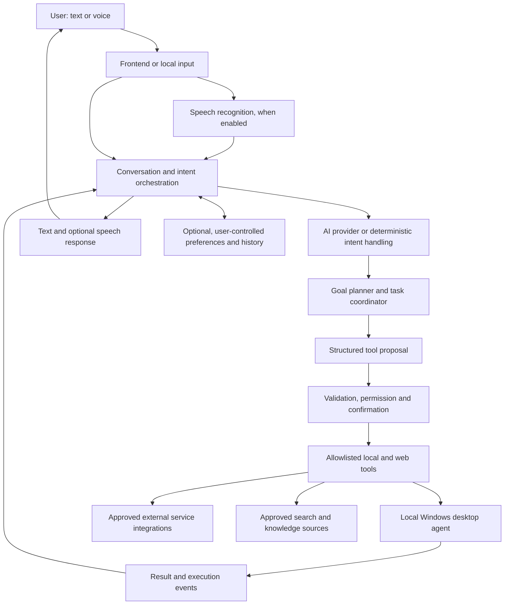

# Cheeni AI System — Detailed Build Plan

## Vision

Build Cheeni toward the feel of a highly capable, context-aware personal AI from science fiction: a natural conversational partner that can understand goals, work across a laptop and connected services, coordinate multi-step tasks, remember user-approved preferences, and offer timely help. The practical target is an extensible assistant that becomes more useful as reliable tools and integrations are added.

Movie-level omnipotence is not a feasible engineering target. Cheeni will be limited by available models, device and service access, network availability, permissions, and the uncertainty of interpreting real-world requests and interfaces. The plan therefore aims for broad capability with transparent limits, visible actions, and user control over consequential decisions.

## Purpose

Evolve the existing Cheeni project into a capable personal AI platform for a Windows laptop. Cheeni should accept typed and spoken requests, answer questions, open apps and websites, work with files, automate selected browser workflows, interact with the visible screen when needed, and coordinate multi-step tasks across approved tools. Over time, it may connect to user-selected services, use user-approved memory, and offer proactive assistance. It should explain its intended actions and keep the user in control of consequential operations.

This document is a planning baseline, not an implementation checklist for work already verified. The repository contains an existing React frontend, Node.js backend, and Python desktop agent. Existing documentation reports completed features, but those claims need to be checked against current behavior before phases are marked complete. Current uncommitted changes must be preserved during assessment.

## Product Principles

- **Local-first desktop control:** laptop actions run through a local Windows agent with access limited to the capabilities the user has enabled.
- **AI interprets; tools execute:** the model may interpret a request and propose a structured action, but application code validates arguments and decides whether execution is allowed.
- **Least privilege:** expose narrow tools for specific tasks instead of unrestricted shell execution or broad filesystem access.
- **Visible, understandable actions:** show what Cheeni understood, what it plans to do, and the result. Support cancellation and recovery where practical.
- **Confirmation proportional to impact:** routine reversible actions can be direct; consequential actions require a clear preview and explicit approval; forbidden actions are rejected.
- **Incremental delivery:** agree on scope and success criteria for each phase, implement one step at a time, and review it before starting the next.
- **Privacy by design:** decide which data stays on the device, which may be sent to an AI provider, what is retained, and how users can inspect or delete stored information.
- **Extensible capabilities:** add new tools and service integrations through explicit, documented interfaces with scoped permissions and health status.
- **Grounded answers:** distinguish retrieved facts, model-generated suggestions, and uncertain conclusions; use current sources when a request needs up-to-date information.
- **Proactive only by agreement:** reminders, monitoring, and suggestions require user-configured scope, schedule, and notification behavior.

## Target Architecture

The existing web dashboard remains the interaction surface for the current milestone, while the local agent owns operating-system actions. Node remains responsible for accounts, cloud model integrations, and synchronized history; the Python agent receives only authenticated, validated requests. A coordinator may propose bounded plans over registered tools. Integrations remain modular. These are working defaults authorized by the owner; deferred provider, memory, browser-session, and distribution decisions still require review when those features are selected.

## Permission Model

| Tier | Examples | Expected behavior |
| --- | --- | --- |
| Read-only / routine | Tell time, report battery, search the web, open an allowlisted app or website | Execute directly and report the result. |
| Modifying / sensitive | Create, move, or rename a file; fill a form; close an app that may contain unsaved work | Preview the target and change. Ask first where the action could overwrite data or lose work. |
| Consequential / external | Delete files, send an email/message, submit a form, make a purchase, install software, run an administrative command, shut down or restart | Require explicit, action-specific confirmation immediately before execution. Never infer confirmation from the original request. |
| Blocked | Destructive access to protected operating-system locations, credential theft, unsafe arbitrary command execution, or attempts to bypass the permission layer | Reject and explain briefly. |

Confirmation should be tied to a pending action, have a short expiry, and be invalidated if the action details change. Voice confirmation should be supplemented by a visible confirmation control for ambiguous or high-impact actions.

## Phase 0 — Project Assessment

### Goal

Establish what the current Cheeni code actually does, what is incomplete, and what should be retained before cleanup or feature work.

### Work

1. Inventory the frontend, Node backend, Python agent, scripts, configuration, documentation, generated files, and dependencies.
2. Review Git status and diffs first; identify uncommitted work and avoid overwriting or deleting it.
3. Trace representative flows end to end: text request, voice request, model response, tool proposal, security classification, confirmation, execution, and user-visible result.
4. Compare advertised capabilities in README and roadmap documents with implemented routes, tools, and UI behavior.
5. Inspect security boundaries: local service binding and authentication, CORS, tool argument validation, filesystem scope, shell/process execution, secrets, and confirmation handling.
6. Identify duplicate implementations, unused dependencies, stale plans, build artifacts, and files that may be candidates for cleanup. Do not remove any until reviewed.
7. Record platform assumptions, startup requirements, external services, and known environment limitations.

### Deliverables

- Component and request-flow map.
- Capability matrix: works, partial, missing, or unverified.
- Keep / repair / consolidate / candidate-for-removal list, with reasons and affected files.
- Risk and dependency summary.
- Recommended architecture choices and a proposed first implementation milestone.

### Completion criteria

- The current system and local changes are documented well enough to make cleanup decisions safely.
- No files or user data have been removed as part of assessment.
- The user has reviewed the proposed scope and architecture before implementation begins.

## Phase 1 — Agree on Architecture and Scope

**Status: Working architecture baseline recorded.** Phase 1 re-baselines the product around a single-owner Windows laptop, React UI, Node backend, authenticated Python OS executor, hybrid AI, Hindi/English language continuity, push-to-talk by default, local-first handling of files/screens, and explicit exclusions for unreviewed high-impact actions. Existing code and user changes remain in place. Sensitive feature decisions still require review before implementation.

### Goal

Choose a coherent product boundary and define what Cheeni is expected to do before changing its architecture.

### Working Decisions and Future Reviews

- **Working baseline:** single-owner Windows laptop; React dashboard; Node API/auth/provider adapter; Python as sole Windows action executor.
- **AI and language:** hybrid deterministic tools plus configured cloud AI; Hindi/English support with same-language replies; no silent provider fallback.
- **Voice and privacy:** browser push-to-talk first; native wake word deferred; file/screen content stays local unless separately disclosed and explicitly requested.
- **Safety:** no arbitrary shell/code, admin, delete, external sending/submission, purchase/install, shutdown/restart, remote control, or unattended consequential action without a dedicated reviewed phase.
- **Future review:** memory/retention, cloud provider specifics, logged-in browser context, connected-service selection, and installer/autostart must be decided before those features begin.
- **Next milestone:** audit the existing Phase 2 foundation against the recorded architecture and select one small user-visible implementation slice.

### Deliverables

- Owner-approved system boundary, trust flow, and component responsibilities.
- Capability scope and explicit non-goals, distinguishing implemented from proposed behavior.
- Data-sharing, storage, retention, memory, voice, and screen privacy decisions.
- Permission and confirmation policy.
- One bounded next milestone with acceptance criteria and manual checks.

### Completion criteria

- No unresolved architectural decision blocks the first milestone.
- The first milestone is small enough to implement and review as a single step.

## Phase 2 — Stabilize the Command Foundation

**Status: Code-level hardening implemented; target-device verification and broader test cleanup remain.** The current command contract is strictly bounded, the direct legacy conversation endpoints are authenticated, native wake-word capture no longer starts at agent boot, and UI action outcomes are surfaced. See [`PHASE_2.md`](PHASE_2.md) for changes and remaining gates. Do not reimplement already-working pieces or remove alternate paths without review.

### Goal

Make a small set of typed commands reliable before expanding voice, filesystem changes, or browser interaction.

### Work

1. Define a structured command and tool interface with explicit names, typed arguments, validation, and result shapes.
2. Route requests through one authoritative orchestration and policy path; avoid independent execution behavior in the UI and backend.
3. Start with a narrow set: open an allowlisted application, open an approved website, open a known folder, and read basic system status. Search is currently represented by opening a validated search URL, not by scraping or browser control.
4. Resolve app aliases through configured mappings or safe discovery; avoid hard-coded assumptions about a single installation path where possible.
5. Return useful status for success, unsupported request, invalid arguments, unavailable agent, and execution failure.
6. Add request identifiers and structured logs that avoid recording secrets or unnecessary file contents.
7. Provide a visible way to see agent connectivity and stop/cancel supported work.

### Deliverables

- Documented tool schema and command flow.
- Working typed-command experience for the agreed starter actions.
- Clear error reporting and agent connection status.
- Focused automated checks for parsing, validation, routing, and policy decisions where the project supports them.

### Completion criteria

- Supported commands reliably invoke only the intended allowlisted tools.
- Unsupported or malformed requests do not fall through to arbitrary shell execution.
- User can understand whether an action ran and why a request failed.

### Implemented slice and current boundaries

- The Python local agent validates registered tools and protects its HTTP routes with the shared bearer token. Node relays authenticated, schema-validated tool requests; the browser does not receive the agent token.
- Initial tools are app launch (small allowlist), standard-folder open, HTTP(S) URL open, and read-only telemetry. Groq tool calling, when configured, is restricted to this same registry.
- Unsupported legacy action types fail closed instead of falling through to shell execution or broad filesystem/window routes.
- Before considering Phase 2 complete, configure the shared token, verify the agent-to-Node request path on the target Windows machine, and address the remaining legacy voice/WebSocket interfaces documented in `PHASE_0_ASSESSMENT.md`.

**Detailed execution document:** [`PHASE_2.md`](PHASE_2.md) defines the route audit, tool contract, safety boundary, implementation work packages, automated/manual test matrix, rollback, and acceptance criteria.

## Phase 3 — Voice Interaction

**Status: Browser push-to-talk, transcript review, bilingual locale selection, and browser TTS are implemented. Native hands-free voice is deferred and fails closed; owner-reviewed target-device microphone/browser validation remains. Detailed execution record: `PHASE_3.md`.**

### Goal

Connect voice input and speech output to the same validated command flow used by typed requests.

### Work

1. Select speech-to-text based on measured needs: browser speech recognition for a simple online-first path, or a local Whisper/Vosk-style option when offline operation or data locality is required.
2. Define microphone permission, activation, wake-word, push-to-talk, and idle behavior.
3. Model voice interaction states such as idle, listening, interpreting, awaiting confirmation, speaking, and error.
4. Handle silence, noise, recognition uncertainty, interruptions, timeouts, and explicit stop phrases.
5. Show recognized text before executing sensitive requests; allow correction or cancellation.
6. Use browser or native text-to-speech according to the chosen deployment model. Keep voice choice, rate, and volume configurable.
7. Ensure typed commands remain available and both input modes share the same policy and tools.

### Implementation update

- Existing browser speech recognition and browser speech synthesis remain the initial voice path; no always-on microphone starts automatically.
- Added an English/Hindi input-language selector to the full dashboard and corner companion. Hindi speech recognition uses the browser's `hi-IN` locale; the selected locale is saved locally. Browser speech recognition does not reliably auto-detect between languages, so users select the language before speaking.
- AI system prompts instruct configured providers to answer in the language of the latest message, preserving natural Hindi-English mixing. TTS selects a voice matching Devanagari Hindi or English text when the browser has one installed; Hindi local action confirmations are also localized.
- Native wake-word status/start/stop now route through authenticated Node endpoints, and the Python voice endpoints require the shared local agent token.
- Direct unauthenticated WebSocket telemetry is rejected. The UI uses authenticated Node polling instead.
- Voice transcripts now open an editable in-app review with explicit Send and Cancel controls; corner and full dashboard modes both use it. No transcript is submitted until Send is selected. Live microphone/TTS checks and reliable interruption behavior still require validation on the target Windows/browser setup.

### Deliverables

- Voice-to-command path using the Phase 2 tools.
- Visible listening and processing states with transcript and cancellation.
- Spoken responses for supported cases, with graceful text fallback.
- Defined behavior when microphone, STT, network, or TTS is unavailable.

### Completion criteria

- Voice commands cannot bypass validation or confirmation.
- Misrecognition is recoverable before consequential actions.
- The assistant can be stopped and does not remain unexpectedly active.

## Phase 4 — Safe File and System Actions

**Status: Single-item preview/confirm file workflow and direct-route hardening pass automated checks. Target-device disposable-folder validation and broader bounded workflows remain. Detailed execution record: `PHASE_4.md`.**

### Goal

Add useful file and system automation with clear targets, constrained access, and safeguards for data-changing actions.

### Work

1. Agree on allowed folders and file types; default to user-selected locations rather than broad disk access.
2. Add file search and read operations, including document extraction for agreed formats.
3. Add create-folder, rename, move, and copy operations with normalized paths and collision handling.
4. Add deletion only after preview, explicit confirmation, and a recovery strategy where feasible (for example, moving to Recycle Bin rather than permanent removal).
5. Add backups and organizing workflows with dry-run previews, item counts, and an undo or rollback plan when practical.
6. Add safe system controls such as volume, battery, CPU/RAM status, and selected window actions using narrow APIs.
7. Treat shutdown/restart, administrative commands, and closing unsaved applications as high-impact operations requiring specific confirmation.
8. Keep arbitrary shell execution disabled by default; if a future use case requires it, define a separate restricted design and approval policy.

### Implementation update

- The Settings panel provides bounded search/read and preview-confirm create-folder, rename, move, and one-file copy/backup within Desktop, Documents, or Downloads. Reads are limited to supported formats and a 2 MiB input size; search is bounded by depth, visited entries, and result count.
- The local agent keeps five-minute previews in a local SQLite journal, binds them to the authenticated account ID, revalidates file identity at commit, rejects collisions, symlinks/reparse points and hard-linked files, and rejects cross-drive moves.
- Rename/move have a separate, confirmed undo preview when the file identity is unchanged. Create-folder and copy do not offer undo; copy retains the source and verifies the destination.
- Direct Python and Node mutation routes and legacy free-form command routes return `410`; native voice file mutations are disabled. File content is not a model tool and the panel does not submit read content to the AI.
- Remaining: recursive folder copy/organization, multi-item transaction and recovery, cleanup/history UX, target Windows/manual-agent review, and full repository test-baseline issues. Delete remains disabled.

### Deliverables

- Documented filesystem boundary and permission tiers.
- Read/search and agreed modification tools with previews and understandable results.
- Confirmation UI/voice flow for destructive or consequential actions.
- Recovery guidance and error handling for partial operations.

### Completion criteria

- Path traversal and protected locations are rejected by the agent, not merely hidden by the UI.
- A user can verify the exact target and intended change before sensitive execution.
- Failures do not silently leave partially completed operations unreported.

## Phase 5 — Browser Workflows

**Status: Public-page fetch hardened; isolated browser automation and user-facing workflows remain deferred. Detailed execution specification: `PHASE_5.md`.**

### Goal

Support selected browser tasks through a controlled, testable automation interface.

### Implementation update

- Hardened the existing read-only page fetcher: it accepts only public HTTP(S) destinations on standard ports, rejects URLs containing credentials and non-global IP resolutions, does not follow redirects, accepts HTML only, and caps response size at 2 MB and extracted text at 20,000 characters.
- Page text remains untrusted input and is not wired into model tools or automatic form actions in this slice.
- No Playwright dependency, signed-in browser profile access, downloads, clicks, form submission, or external sending were enabled. The recommended next browser milestone is a dedicated isolated Playwright context with named read-only workflows and explicit data disclosure.

### Work

1. Start with opening URLs, web search, extracting page text, and summarizing retrieved content.
2. Choose a browser strategy per workflow: Playwright-managed context for repeatable isolated automation, or an explicitly authorized existing session when the user needs their signed-in profile.
3. Define allowed domains, navigation behavior, download handling, and treatment of page content as untrusted input.
4. Build named workflows for specific tasks rather than granting a general-purpose agent unconstrained clicking.
5. Show a preview before form submission, email/message sending, purchases, or sharing data; require explicit confirmation at the final external action.
6. Avoid storing passwords or session cookies in Cheeni. Use browser-managed authentication and explain what data is visible to cloud models.
7. Report which page was used, what was read or changed, and whether the workflow completed.

### Deliverables

- Browser workflow design and privacy decision.
- A small set of agreed automation flows with clear start and stop behavior.
- Confirmation and preview behavior for external submissions.
- Error handling for changed page layouts, login challenges, and browser disconnects.

### Completion criteria

- Page content cannot redefine Cheeni's tools, permissions, or system instructions.
- External actions remain pending until the user approves the exact action.
- Workflow failures are visible and do not claim success without evidence.

## Phase 6 — Screen Understanding and Personalization

**Status: On-demand screen Q&A wired with explicit cloud disclosure; runtime/provider validation remains.**

### Goal

Add visual UI interaction and optional personalization only after API-based desktop and browser controls are dependable.

### Implementation update

- Replaced the incomplete screenshot-to-text placeholder with an authenticated Node-to-agent vision request. The user must approve a clear prompt before the primary-screen image is sent to the configured Google Gemini vision model.
- Screen analysis is answer-only in this slice: it cannot click, type, or trigger desktop actions. The image is captured in memory and is not persisted by this flow.
- Screen text is explicitly treated as untrusted input by the vision prompt. Capture failures now report failure instead of returning a fabricated blank-screen image.
- No long-term memory or preferences were added. Visual UI interaction, user-visible capture indicator beyond the consent prompt, and live Windows/provider checks remain.

### Work

1. Identify tasks that cannot be served reliably by existing application APIs or browser automation.
2. Choose screenshot capture, OCR, accessibility/UI automation, or a vision model based on the task and privacy constraints.
3. Keep screen capture on demand, disclose when it is active, and minimize retention of screenshots or extracted text.
4. Make each click/type action observable; support stop, review, and recovery from unexpected screen changes.
5. Require confirmation before actions that submit, send, delete, purchase, install, or expose private information.
6. Add optional preferences such as app aliases, response style, and chosen workflows, with controls to view, edit, export, and erase them.
7. Define memory boundaries: preferences versus conversation history versus sensitive information; do not retain credentials or infer sensitive facts as preferences.

### Deliverables

- Screen-control prototype for a narrowly chosen workflow, if justified.
- User-visible capture and action states with stop/cancel behavior.
- Optional memory controls and documented retention behavior.

### Completion criteria

- Visual automation is limited to the agreed workflow and cannot silently perform external or destructive actions.
- User can see and stop the interaction.
- Stored personalization can be reviewed and deleted.

## Phase 7 — Connected Services and Extensible Tools

**Status: Completed. Full token encryption (AES-256-GCM), OAuth 2.0 PKCE connect/disconnect/revocation routes, user isolation, dynamic catalog status, IntegrationsPanel UI with Navbar badge, and untrusted Google Calendar event reader tool implemented and verified.**

### Goal

Let Cheeni work across services the user explicitly chooses, using a modular integration model instead of hard-wiring each service into the conversation logic.

### Implementation update

- Added an integration catalog contract with stable IDs, connection state, authorization method, per-operation access level, narrow OAuth scopes, data-sharing notes, and confirmation requirements (Google Calendar, Gmail Draft, GitHub Status).
- Implemented AES-256-GCM token encryption (`backend/utils/tokenEncryption.js`) storing encrypted tokens in the user's MongoDB record, stripped from all JSON serializations.
- Implemented OAuth 2.0 PKCE flow (`/connect`, `/callback`, `/:id/disconnect`) with state HMAC CSRF protection and remote token revocation.
- Registered AI-callable `list_calendar_events` tool bounded by 31-day date range validation, HTML sanitization, and 50 KB untrusted data cap.
- Built slide-over `IntegrationsPanel` UI and dynamic Navbar badge with connect/disconnect flows and OAuth redirect toast notifications.
- All 76 backend tests and frontend Vite production builds pass.

### Work

1. Define a tool registry describing each tool's purpose, arguments, permissions, data sent, and supported operations.
2. Add integrations one at a time based on real user workflows, such as calendar, email drafting, task lists, cloud storage, or messaging.
3. Use official APIs and delegated authorization where available; request only the scopes needed for the selected workflow.
4. Keep credentials and tokens in an appropriate protected store; provide revoke/disconnect controls and never expose secrets to the model or logs.
5. Separate read, draft, and external-write operations. Drafting can be offered as a lower-impact action; sending or publishing requires a final review and explicit approval.
6. Report service connectivity, authorization state, rate limits, and partial failures.
7. Treat external content, documents, and tool output as untrusted data; they cannot grant themselves permissions or redefine Cheeni's policies.

### Deliverables

- Tool registry and integration contract.
- One or more user-selected integrations with documented scopes and data flows.
- Connect, disconnect, and permission review experience.
- Clear handling for expired authorization and unavailable services.

### Completion criteria

- Each integration has a narrow permission scope and can be disabled independently.
- Cheeni does not claim an external action succeeded without a service response confirming it.
- External messages, posts, submissions, and other consequential writes require a user review and explicit approval.

## Phase 8 — Multi-Step Goal Planning and Task Coordination

**Status: Completed. Validated 2–5 step plan generation, exact SHA-256 digest cryptographic approval binding, sequential step-by-step execution engine, pause/resume/cancel controls, and user-facing TaskPlanCard UI fully wired and verified behind `TASK_EXECUTION_ENABLED=true`.**

### Goal

Allow Cheeni to turn a larger request into a plan, perform safe steps, and ask the user when a decision or approval is needed.

### Implementation update

- Implemented plan generation and formatting in `backend/services/taskPlan.service.js` with allowlist step validation (`validateDesktopTool`) and strict 2–5 step boundaries.
- Wired Gemini function calling in `backend/services/ai.service.js` and Groq agent in `backend/services/groqAgent.service.js` to build preview task plans when multiple tools are proposed.
- Implemented `backend/services/taskExecution.service.js` with SHA-256 canonical digest computation, MongoDB persistence (`TaskPlan`), exact-digest matching approval, single-step advancing with result recording, and pause/resume/cancel handlers.
- Exposed RESTful task endpoints in `backend/routes/task.routes.js` (`/api/tasks`) protected by `isAuth` and feature flag `TASK_EXECUTION_ENABLED`.
- Added interactive `TaskPlanCard` component in `frontend/src/components/home/TaskPlanCard.jsx` and mounted in `Home.jsx` supporting approval, step execution, and live status tracking.
- All backend tests (76 passing) and frontend Vite production builds pass with zero errors.

### Work

1. Represent a task as a sequence or dependency graph of typed tool calls, expected outcomes, and checkpoints.
2. Show the plan before execution when it spans multiple tools, changes data, or has external effects.
3. Execute one bounded step at a time, checking tool results before choosing the next step.
4. Reconfirm if the plan changes materially, targets a different resource, or encounters an unexpected prompt or result.
5. Support pause, cancel, and safe resume; persist only the minimum task state needed and disclose where it is stored.
6. Track provenance: which results came from tools, which came from model reasoning, and what remains uncertain.
7. Prevent loops and runaway retries with time, action, and resource limits.

### Deliverables

- Reviewable task plan and step-by-step execution view.
- Pause, cancel, timeout, and failure-recovery behavior.
- A small set of end-to-end workflows using already approved tools.

### Completion criteria

- Cheeni verifies each completed step instead of assuming success.
- User approval is obtained before consequential steps and after material plan changes.
- A failed step stops or safely replans rather than continuing with invalid assumptions.

## Phase 9 — Proactive Assistance and Ongoing Improvement

**Status: Completed. User-isolated browser-local reminder engine (one-time, daily, weekly), missed-run resilience (> 15 min), notification deduplication, and automated component test suite (5 tests) verified.**

### Goal

Offer useful reminders and monitoring that the user explicitly configures, with predictable timing, quiet behavior, and easy controls.

### Implementation update

- Added opt-in one-time, daily, and weekly reminders stored in browser `localStorage`, namespaced by signed-in user ID. Switching accounts reloads that account's reminder list. No reminder text is sent to Cheeni's backend or an AI provider.
- The reminder manager supports add, edit, pause/resume, run-now, dismiss, and delete. Browser notifications are requested only after the user selects the enable button; otherwise due reminders appear in the app while it is open. Recurrence preserves local wall-clock time across daylight-saving transitions.
- Reminders are checked while the dashboard is running. One-time reminders over 15 minutes late are marked missed; recurring reminders advance to the next scheduled occurrence. Reminders do not run while the browser/app is closed, and there is no server worker, monitoring, or external action.
- Added comprehensive unit test suite in `frontend/src/components/ReminderManager.test.jsx` (5 tests passing).

### Work

1. Add opt-in reminders and scheduled tasks with clear schedules, time zones, and destinations.
2. Add monitoring only for user-selected events or sources, with a defined check interval and notification threshold.
3. Keep unchanged or non-actionable checks quiet unless the user requests status updates.
4. Provide pause, edit, run-now, history, and delete controls for every recurring task.
5. Require review before a scheduled task performs a consequential external write or destructive operation; unattended approval must not be inferred.
6. Report missed runs, service outages, and stale data instead of presenting old information as current.
7. Use user feedback to improve aliases and preferences without silently expanding permissions.

### Deliverables

- User-controlled reminders and scheduled checks.
- Notification preferences and execution history.
- Clear pause/delete controls and failure reporting.

### Completion criteria

- Every recurring behavior is visible and can be stopped by the user.
- Notifications reflect verified, current results and respect the configured quiet behavior.
- Scheduling never silently grants broader authority than an interactive task.

## Remaining Capability Delivery Phases

Work proceeds in order. Implement one small slice, test it against that phase's gate, review the result, and only then continue. A failed test blocks progression until fixed or explicitly accepted as a known limitation. No phase inherits broader permissions from another phase.

### Phase 10 — Validate the Foundation and Finish Voice Basics

**Scope:** Verify browser voice, Hindi/English input and matched-language responses, speech output, safe app/site/folder launch, and agent connectivity on the target Windows laptop. Add user-configurable aliases for apps, websites, and folders. Assess native wake-word support separately; it remains opt-in.

**Detailed execution document:** `PHASE_10.md` contains the expanded work breakdown, safety constraints, automated and manual test plans, acceptance criteria, dependencies, and completion record. Update its completion table as each check is run; do not start Phase 11 until Phase 10 is reviewed.

**Preparation and execution order:**

1. **10.1 Baseline and safety audit:** Inventory the exposed tool schemas, Node routes, Python agent routes, and UI entry points. Confirm model-driven actions use the validated registry; identify authenticated legacy routes that are not safe to expose to the model. Record current tests and known failures before changing behavior.
2. **10.2 Environment readiness:** Verify supported Node/Python versions, startup instructions, local agent health, and that matching `AGENT_API_TOKEN` values are configured locally. Never display, copy into the plan, or commit secret values. If a token or provider key is missing, record the blocker and continue only with tests that do not require it.
3. **10.3 Hindi/English voice test:** In the full dashboard and corner companion, select each mic locale (`en-IN`, `hi-IN`), capture a short sample, inspect/correct the transcript, and cancel one request. Confirm Hindi text results in Hindi response text and English text in English, including model answers and supported local-action confirmations. Confirm TTS selects the matching installed voice; record a text-only fallback when Hindi TTS is unavailable. Do not claim automatic speech-language detection—the browser requires the user to select the spoken language.
4. **10.4 App/site/folder alias design:** Define the alias format and storage before implementation. Resolve aliases only to canonical allowlisted app IDs, HTTPS website destinations, or standard folders under approved roots. Reject unknown aliases, executable paths, arbitrary filesystem paths, unsafe URL schemes, and aliases that alter safety policy. Keep credentials out of aliases.
5. **10.5 Starter action tests:** Test one allowlisted application, one HTTPS website, and each supported standard folder; test malformed and unsupported requests; confirm the UI reports success only after an agent result. Test disconnected-agent behavior without falling back to shell execution.
6. **10.6 Target-device review:** On the owner’s Windows machine, record OS/browser versions, microphone permission, available recognition locales, installed Hindi/English TTS voices, and setup requirements. Assess native wake-word voice separately; it is not enabled by this phase.

**Automated test gate:** Cover locale selection persistence and forwarding, same-language response instructions, Hindi local confirmations, tool/alias allowlisting, URL/path validation, malformed input, and agent-offline handling. Existing tests must remain green; add focused tests for any alias behavior implemented here.

**Manual test matrix:**

| Scenario | Expected result |
| --- | --- |
| Select English and speak an English request | English transcript and answer; matching English TTS if installed. |
| Select हिन्दी and speak a Hindi request | Hindi transcript and answer; matching Hindi TTS if installed. |
| Edit transcript before sending | Only edited text is submitted. |
| Cancel transcript review | No request or desktop action is sent. |
| Ask for a configured app/site/folder alias | Alias resolves only to its approved target and reports the actual result. |
| Ask for unknown alias, unsafe URL, or arbitrary path | Request is rejected; nothing launches or opens. |
| Stop listening or disconnect the agent | Listening stops or a clear unavailable error appears; no unsafe fallback occurs. |

**Exit:** Starter commands work in both languages, limitations are documented, and no unaudited legacy path is represented as supported.

### Phase 11 — Safe File Changes and Recovery

**Scope:** Add user-facing search/read, then exact-target previews for create-folder, rename, move, copy, and selected organize/backup workflows. Restrict access to approved roots and provide undo/recovery where reliable. Keep deletion disabled until its separate Recycle Bin/recovery design is reviewed; arbitrary shell/admin commands stay disabled.

**Detailed execution document:** `PHASE_11.md` defines the filesystem policy, preview/confirmation lifecycle, operation journal and undo boundaries, legacy-route retirement, automated and manual tests, acceptance criteria, and completion record. Follow its gates in order; do not expose direct mutation routes or begin Phase 12 before owner review.

**Test gate:** Automated tests cover traversal, symlinks, allowed roots, collisions, confirmation expiry, changed targets, rollback, and partial failures. Manual tests use disposable folders to verify preview, confirm, cancel, and recovery before real files are touched.

**Exit:** Every mutation previews exact source/destination and impact; protected locations are inaccessible; failure and recovery outcomes are visible.

### Phase 12 — Named Browser Workflows

**Scope:** Integrate public-page search/read/summarization, then implement an isolated browser context and one owner-selected workflow. Do not reuse personal cookies or store passwords. Form submission, sending, purchases, and data sharing require final action-specific confirmation.

**Test gate:** Automated tests cover URL/SSRF policy, redirects, downloads, hostile page content, timeouts, and workflow state. Manual tests verify isolation, login boundaries, layout-change failures, action preview, and cancellation before external submission.

**Exit:** The workflow is repeatable, reports what it read/changed, stays inside its domain policy, and never submits without explicit approval.

**Detailed execution document:** [`PHASE_12.md`](PHASE_12.md) covers the implementation sequence, threat boundaries, API/state flow, tests, and acceptance checklist.

### Phase 13 — Narrow Screen Interaction

**Scope:** Extend on-demand screen Q&A into one selected visual workflow using accessibility/UI APIs or vision. Add visible capture/action state, step-by-step observation, stop, and recovery. Disable general-purpose clicking/typing outside the selected workflow.

**Test gate:** Automated tests cover action bounds, screenshot handling, untrusted screen text, stop requests, and unexpected UI. Manual target-device checks verify disclosure, targeting, cancellation, and confirmation before external/destructive actions.

**Exit:** The workflow is observable, stoppable, handles unexpected screens safely, and passes owner review on Windows.

**Detailed execution document:** [`PHASE_13.md`](PHASE_13.md) covers the current Q&A baseline, consent/privacy boundaries, single-workflow design, UI action policy, cancellation/recovery, testing, and release criteria.

### Phase 14 — One User-Selected Connected Service

**Scope:** Select one workflow (for example, read calendar events or draft email). Implement its official API, least-privilege delegated authorization, protected token storage, connect/disconnect/revoke controls, and data-sharing disclosure. Keep drafting separate from sending.

**Test gate:** Automated tests cover OAuth state/CSRF, scopes, token secrecy, user isolation, revoked/expired access, rate limits, and provider errors. Manual tests use a test account and verify actual permissions.

**Exit:** The user can inspect/revoke access, results are verified, and external writes require review and explicit approval.

**Detailed execution document:** [`PHASE_14.md`](PHASE_14.md) defines provider selection, OAuth/CSRF protections, token handling, consent/data minimization, operation boundaries, tests, and release gates.

### Phase 15 — Approved Multi-Step Execution

**Scope:** Turn preview-only plans into reviewable tasks with exact-plan approval, one bounded step at a time, verified results, pause/cancel, expiry, and minimal persistence. Stop on failure or changed assumptions; reconfirm material changes. Never infer approval from the original request.

**Test gate:** Automated tests cover plan validation, user isolation, stale/duplicate approvals, expiry, cancellation, resource limits, restart behavior, tool failures, and unauthorized calls. Manual tests exercise approve, reject, pause, resume, cancel, and partial failure.

**Exit:** Each step is authorized and verified; the user can stop the task; failure cannot trigger unsafe continuation or retries.

**Detailed execution document:** [`PHASE_15.md`](PHASE_15.md) covers the existing preview baseline, eligible-tool policy, exact-plan approval, sequential state machine, recovery, persistence, tests, and release gates.

### Phase 16 — Background Reminders and Monitoring

**Scope:** Decide deployment and notification delivery before adding a scheduler. Migrate reminders only with consent. Add schedules, time zones, quiet behavior, monitoring sources/intervals, history, missed-run reporting, and pause/delete. Never let unattended tasks perform consequential writes.

**Test gate:** Automated tests cover time zones/DST, duplicate delivery, restart/retry, quiet hours, missed runs, stale data, authorization, and opt-out. Manual tests verify delivery, pause/delete, outages, and quiet behavior.

**Exit:** Every task is visible, bounded, stoppable, privacy-reviewed, and reports verified results; no unattended external/destructive action is enabled.

### Per-Phase Working Agreement

For each phase, agree on the exact user-visible slice and safety limits, implement it, run automated checks, perform the relevant manual test with the owner, record the result, and then proceed. If credentials, a live account, or target-device access are required, pause at that phase's test gate rather than claiming completion.

## Cross-Phase Quality and Operations

- Keep secrets out of source control and logs; use environment configuration and safe examples.
- Bind local agent endpoints to loopback by default and authenticate/authorize requests from the dashboard.
- Validate requests at the agent boundary even if the frontend and Node backend already validate them.
- Use timeouts, cancellation, and clear health checks for service-to-service calls.
- Keep dependencies purposeful; document installation and supported Windows/Python/Node versions.
- Add focused tests when each behavior is implemented, plus manual checks for microphone, OS integration, and confirmation UX.
- Document startup, shutdown, configuration, data flow, permissions, known limitations, and recovery steps.
- Do not treat a phase as complete based solely on a roadmap checkbox; record what was verified and how.
- Treat model output as fallible: validate tool arguments, verify results, surface uncertainty, and keep policy enforcement outside the model.
- Design integrations to fail independently; loss of one model, service, or network connection should not silently alter permissions or execute a different action.

## Step-by-Step Working Agreement

For each implementation step:

1. State the user-visible goal and what is in scope.
2. Agree on technology choices only when they affect that step.
3. Define acceptance criteria and relevant safety/privacy behavior.
4. Inspect affected files and preserve unrelated user changes.
5. Implement the smallest complete slice.
6. Run focused verification appropriate to the change and report the results and limitations.
7. Review the outcome together before moving to the next step.

## Phase 0 Assessment Result

The static assessment is recorded in `PHASE_0_ASSESSMENT.md`. It identified overlapping execution paths, missing authentication on local agent endpoints, unguarded experimental ReAct dispatch, and an unauthenticated cloud-to-device bridge. No project files were deleted; existing changes and experimental files were preserved.

The first implementation slice adds an authenticated local tool boundary for allowlisted app launch, standard user folders, safe URL opening, and read-only telemetry. It disables cloud bridge startup and the separate ReAct endpoint. The implementation is in the working tree but needs matching `AGENT_API_TOKEN` values in both `.env` files before desktop API calls will work. The assessment report records remaining legacy interfaces and verification limits.

**Remaining verification:** configure matching `AGENT_API_TOKEN` values in the backend and local agent environments, then exercise the desktop routes on the target Windows machine. Do not commit actual secrets.

## Phase 1 Architecture Draft

The component boundaries, data flow, default technology direction, initial scope, and deferred decisions are in `PHASE_1_ARCHITECTURE.md`. The working defaults are accepted for implementation; the decisions listed there remain open for later user-facing choices. No code changes were made solely for the architecture draft.

## Remaining Work and External Validation

The current milestone has a secure starter path and implemented slices across Phases 2–9, but the end-state roadmap is not fully complete. Remaining work that cannot be safely finalized from this repository alone:

- **Phases 2–4, 6:** configure local secrets privately and validate agent, microphone, speaker, screen capture, and Windows actions on the owner's machine. Legacy routes require a route-by-route audit before they are exposed to AI tools; do not equate authenticated access with an appropriate permission policy.
- **Phase 4:** provide a user-facing scoped file search/read workflow and safe, recoverable create/rename/move operations. Deletion, arbitrary shell, admin commands, shutdown, and restart remain unavailable to model-driven execution.
- **Phase 5:** choose a dedicated browser profile and the first named workflow. Signed-in browsing and form submission are intentionally not enabled pending privacy and approval design.
- **Phase 6:** add user-managed preference/memory review and deletion controls before retaining new personalization. Screen Q&A needs a real device/provider check; screen clicking is not implemented.
- **Phase 7:** choose an integration and exact workflow, then supply/configure its official OAuth client and account consent. Google Calendar is catalog-only, not connected.
- **Phase 8:** add explicit task-plan review/approval, bounded step execution, pause/cancel, and persistence only after the UI and permission model are agreed; current multi-step output is preview-only.
- **Phase 9:** reminders are browser-local and run only while the app is open. Background delivery and event monitoring require a deployment/scheduler and notification destination decision.

These are explicit dependencies, not claims of completed features. A later step should be selected only after the required account access, privacy choices, or target-device validation is available.
