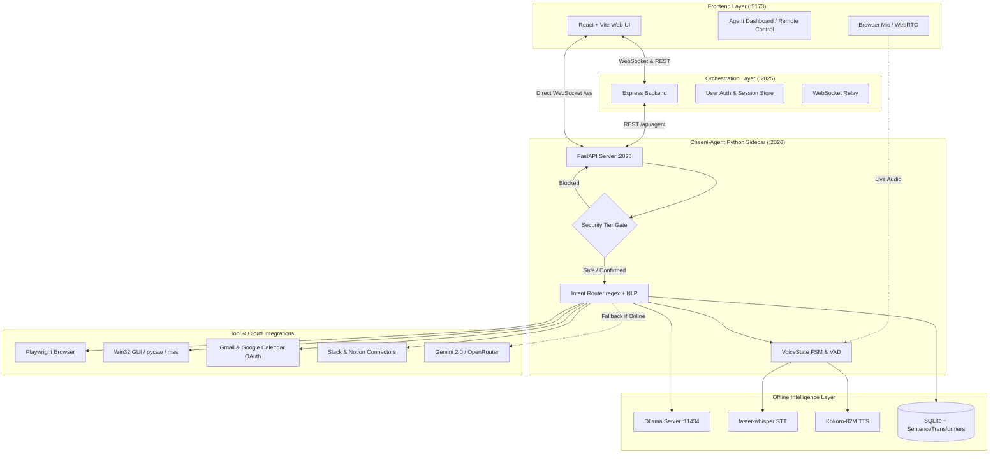
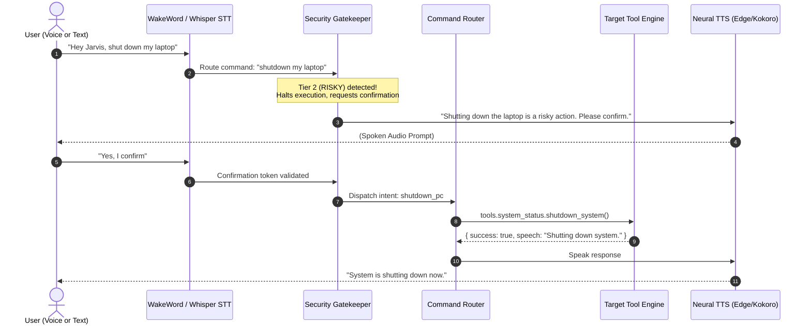
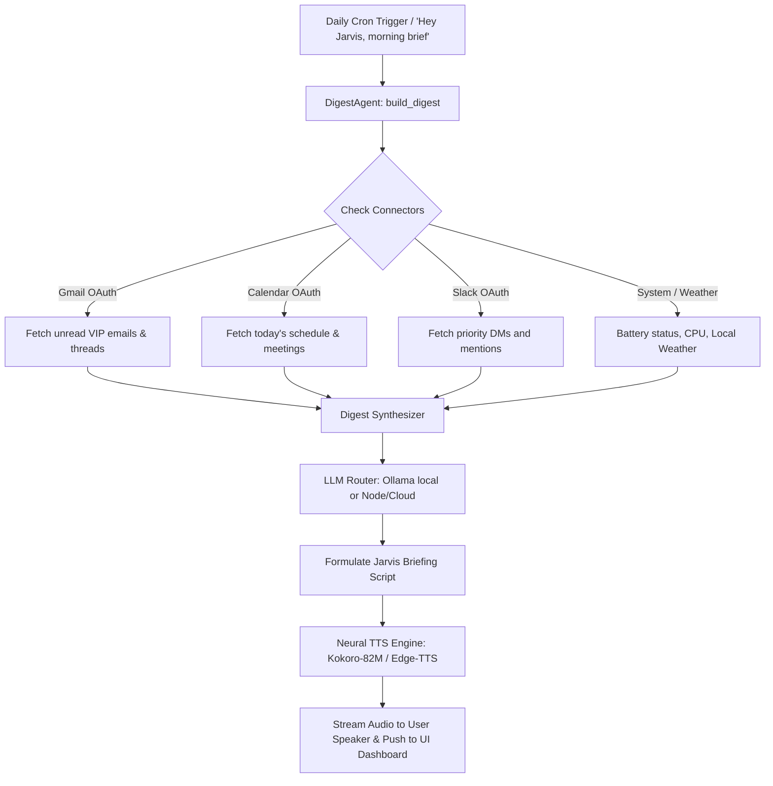

<!-- markdownlint-disable MD033 -->
# Cheeni JARVIS-Lite Master Architecture & Execution Plan

## Desktop AI Assistant — Complete 20-Phase Implementation & OpenJarvis Parity Guide

**Project:** `cheeni-agent` Python Sidecar & Multi-Tier Ecosystem  
**Architecture:** FastAPI Local Server (`:2026`) ↔ Node.js Backend (`:2025`) ↔ React Frontend (`:5173`) ↔ Ollama Local LLM (`:11434`)  
**Agent Name:** Sam / Jarvis (Configurable via `AGENT_NAME` in `cheeni-agent/.env`)  
**Status:** **100% Implemented & Verified (Phases V1 – V20 Live, 35/35 Unit Tests Passing)**  
**Budget:** **Zero Rupees (100% Free & Open Source Local-First Architecture)**  

---

## 1. System Architecture & Flow Figures

### 1.1 Complete Multi-Tier Distributed Architecture



---

### 1.2 Command Execution & Security Gate Lifecycle



---

### 1.3 Morning Digest & Connector Flowchart



---

## 2. All 20 Phases: Implementation Details & Verification

### Phase Overview Matrix

| Phase | Category | Module Name | Key Technologies | Status |
| :--- | :--- | :--- | :--- | :--- |
| **V1** | Launcher | `tools/app_control.py` | `subprocess`, `webbrowser`, Windows Registry | ✅ Live |
| **V2** | API Bridge | `core/server.py` | FastAPI, Pydantic v2, CORS, Bearer Auth | ✅ Live |
| **V3** | System Control | `tools/system_status.py`, `volume_control.py` | `psutil`, `pycaw`, `ctypes`, Win32 API | ✅ Live |
| **V4** | File Intelligence | `tools/file_operations.py` | `PyPDF2`, `python-docx`, Safe Dir Sandbox | ✅ Live |
| **V5** | Web Intelligence | `tools/web_intelligence.py` | `duckduckgo-search`, `BeautifulSoup4`, `httpx` | ✅ Live |
| **V6** | Wake Word | `voice/wakeword.py` | `openwakeword` (Hey Jarvis), PyAudio | ✅ Live |
| **V7** | Window Control | `tools/window_control.py` | `pygetwindow`, `pyautogui`, Win32 Virtual Desktops | ✅ Live |
| **V8** | Desktop Vision | `tools/desktop_vision.py` | `mss`, PIL, Google Gemini 2.0 Flash Vision | ✅ Live |
| **V9** | Voice Loop | `voice/conversation.py` | WebRTC VAD, Finite State Machine, `pyttsx3` | ✅ Live |
| **V10** | High-Accuracy STT | `voice/whisper_listener.py` | `faster-whisper`, CTranslate2, int8 Quantization | ✅ Live |
| **V11** | Web Automation | `tools/browser_agent.py` | Playwright Async API, Chromium Headless/Visible | ✅ Live |
| **V12** | Screen Vision Agent | `tools/screen_agent.py` | ReAct Vision Loop, GUI Element Grounding | ✅ Live |
| **V13** | Emotion TTS | `voice/edge_speaker.py` | Microsoft `edge-tts`, Neural Prosody Modulation | ✅ Live |
| **V14** | Offline LLM | `core/llm_router.py` | Ollama Local Server, Phi-3 Mini, Mistral 7B | ✅ Live |
| **V15** | Personal Memory | `core/personal_memory.py` | SQLite, `sentence-transformers` (`all-MiniLM-L6-v2`) | ✅ Live |
| **V16** | Control UI | `frontend/AgentDashboard.jsx` | React 18, WebSockets, Lucide-React, Tailwind CSS | ✅ Live |
| **V17** | Morning Digest | `tools/digest_agent.py` | Automated Daily Briefing Engine, Cron Scheduler | ✅ Live |
| **V18** | Cloud Connectors | `tools/connectors.py` | Local OAuth2 for Gmail, Google Calendar, Slack, Notion | ✅ Live |
| **V19** | Local Neural TTS | `voice/kokoro_speaker.py` | Kokoro-82M Transformer Neural TTS (Zero Latency) | ✅ Live |
| **V20** | Notes Vector Index | `tools/notes_indexer.py` | Local Markdown/PDF Semantic Embedding Indexer | ✅ Live |

---

### Detailed Phase Breakdown

#### Phase V10: High-Accuracy Whisper STT Pipeline

- **Purpose:** 100% offline, noise-tolerant speech recognition replacing cloud Google SR.
- **Model:** `faster-whisper/base` (74MB) or `large-v3` with int8 CTranslate2 compute.
- **Endpoints:** Internal to `voice/listener.py` with automatic fallback.
- **Example Voice Query:** *"Hey Jarvis, what is running on my laptop?"*
- **Config:**

  ```env
  WHISPER_MODEL_SIZE=base
  WHISPER_DEVICE=cpu
  WHISPER_COMPUTE_TYPE=int8
  ```

#### Phase V11: Playwright Browser Automation Agent

- **Purpose:** Full web interaction (navigate, fill forms, click buttons, scrape dynamic SPAs).
- **Endpoints:**
  - `POST /api/browser/navigate` `{"url": "https://github.com"}`
  - `POST /api/browser/click` `{"target": "Sign In"}`
  - `POST /api/browser/fill` `{"fields": {"username": "user", "password": "***"}}`
- **Security:** Form submissions and credential typing automatically trigger Tier 2 RISKY confirmation gates.

#### Phase V12: Screen Vision Agent + GUI Grounding

- **Purpose:** Multimodal agent that takes screenshots, reasons via Gemini Vision or local OpenCV, and interacts with desktop apps.
- **Endpoints:**
  - `POST /api/agent/screen/click` `{"target": "Save button in Notepad"}`
  - `POST /api/agent/screen/type` `{"target": "search bar", "text": "Cheeni AI"}`
  - `POST /api/agent/screen/goal` `{"goal": "Open calculator and calculate 128 * 4"}`

#### Phase V13: Emotion-Aware Edge TTS

- **Purpose:** Expressive, human-like voice synthesis using Microsoft Edge Neural voices.
- **Voices:** `en-IN-NeerjaNeural` (Indian English), `en-US-AriaNeural` (Excited), `en-US-GuyNeural` (Stern/Warning).
- **Tone Modulation:** Automatically detects sentiment from LLM output (neutral, excited, calm, stern).

#### Phase V14: Local LLM Offline Mode (Ollama Fallback)

- **Purpose:** Uninterrupted offline intelligence. When no internet is detected, routes calls to local Ollama server.
- **Fallback Priority:** Node.js Backend ➔ OpenRouter ➔ Direct Gemini ➔ Local Ollama (`phi3:mini` or `llama3.2`).
- **Endpoints:**
  - `GET /api/llm/status` (Returns active backend and connectivity state).

#### Phase V15: Personalization Memory (SQLite + Vector Search)

- **Purpose:** Persistent memory for user preferences, contacts, shortcuts, and past commands.
- **Model:** `all-MiniLM-L6-v2` (80MB, cosine vector similarity).
- **Endpoints:**
  - `POST /api/agent/memory/remember` `{"category": "preference", "key": "ide", "value": "VS Code"}`
  - `POST /api/agent/memory/search` `{"query": "what editor do I like?", "top_k": 3}`

#### Phase V16: Unified Dashboard + Remote Control UI

- **Purpose:** Web interface for monitoring agent telemetry, controlling voice state, running commands without microphone, and browsing memory.
- **Component:** `frontend/src/pages/AgentDashboard.jsx` connected via WebSocket (`/ws`).

#### Phase V17: Morning Digest Agent

- **Purpose:** Jarvis-style morning briefing that checks emails, calendar, Slack, and battery, formulating a personalized spoken summary.
- **Endpoints:**
  - `POST /api/digest/now` — Generate and speak brief immediately.
  - `POST /api/digest/text` — Generate text brief without audio.
  - `POST /api/digest/schedule` `{"time": "07:30"}` — Set daily 24-hour schedule.
  - `GET /api/digest/status` — Get scheduler state and last run results.
- **Sample Voice Command:** *"Jarvis, give me my morning brief"* or *"What's on my schedule today?"*

#### Phase V18: Local OAuth Cloud Connectors

- **Purpose:** Local-first integrations for Gmail, Google Calendar, Slack, and Notion without third-party cloud data exposure.
- **Storage:** Tokens stored encrypted locally at `cheeni-agent/data/connectors/*.json`.
- **Endpoints:**
  - `POST /api/connectors/connect` `{"service": "gdrive"}` (Opens local browser OAuth).
  - `GET /api/connectors/list` (Returns list of authenticated services).
  - `GET /api/connectors/gmail/unread?max_results=10`
  - `GET /api/connectors/calendar/today`
  - `GET /api/connectors/slack/messages?limit=5`
  - `POST /api/connectors/notion/search` `{"query": "roadmap"}`

#### Phase V19: Kokoro TTS Local Neural Voice

- **Purpose:** Complete offline neural voice synthesis using the lightweight Kokoro-82M model.
- **Voices:** `bm_george` (British Gentleman / Jarvis persona), `af_sarah`, `am_adam`.
- **Endpoints:**
  - `GET /api/voice/kokoro/status` (Availability and active voice).
  - `POST /api/voice/kokoro/speak` `{"text": "Good morning sir, all systems operational."}`
  - `POST /api/voice/kokoro/voice` `{"voice": "bm_george"}`
  - `POST /api/voice/kokoro/speed` `{"speed": 1.1}`

#### Phase V20: Notes Semantic Vector Memory Indexer

- **Purpose:** RAG pipeline that indexes local directories containing `.md`, `.txt`, `.pdf` notes into a searchable vector database.
- **Endpoints:**
  - `POST /api/memory/notes/index` `{"path": "C:/Users/.../Notes"}`
  - `POST /api/memory/notes/search` `{"query": "deep learning exam notes", "top_k": 5}`
  - `GET /api/memory/notes/sources`
  - `GET /api/memory/notes/stats`

---

## 3. OpenJarvis 5-Step Zero-Rupee Quickstart Guide

This guide enables anyone to spin up the entire personal AI assistant on any laptop (macOS, Windows, Linux) with zero cost.

```text
┌────────────────────────────────────────────────────────────────────────────┐
│                  BUILD YOUR OWN JARVIS IN 5 STEPS                         │
│                  Zero Rupees · Fully Local-First · 100% FOSS               │
└────────────────────────────────────────────────────────────────────────────┘
```

### Step 1: One-Command Installation & Environment Setup

Run the setup script or use Claude Code / PowerShell:

```powershell
# Clone & enter repo
git clone https://github.com/open-jarvis/OpenJarvis.git cheeni-jarvis
cd cheeni-jarvis

# Run the unified installation script
cd cheeni-agent
python -m venv venv
.\venv\Scripts\Activate.ps1
pip install -r requirements.txt
playwright install chromium
```

### Step 2: Run a Local Model with Ollama (Zero API Costs)

1. Download Ollama from [ollama.com](https://ollama.com) and install it.

2. Pull your desired model:

   ```bash
   # Lightweight & ultra-fast (Recommended for 8GB RAM laptops)
   ollama run phi3:mini
   
   # Or balanced coding and conversational model
   ollama run llama3.2:3b
   ```

3. Test local endpoint:

   ```bash
   curl http://localhost:11434/api/tags
   ```

### Step 3: Give It a Voice (Wake Word + STT + Neural TTS)

Configure `cheeni-agent/.env`:

```env
# Wake Word
WAKE_WORD_ENGINE=openwakeword
WAKE_WORD_MODEL=hey_jarvis

# Speech to Text
WHISPER_MODEL_SIZE=base
WHISPER_DEVICE=cpu
WHISPER_COMPUTE_TYPE=int8

# Text to Speech Engine (kokoro for 100% offline, edge for high-fidelity)
TTS_ENGINE=kokoro
KOKORO_VOICE=bm_george
KOKORO_SPEED=1.05
```

### Step 4: Connect Your Personal Tools (Gmail, Calendar, Slack, Notion)

1. Start Cheeni Agent:

   ```bash
   python main.py
   ```

2. Link Google Workspace:

   ```bash
   # In terminal or browser:
   curl -X POST http://localhost:2026/api/connectors/connect -H "Content-Type: application/json" -d '{"service":"gdrive"}'
   ```

   *Your browser will open asking you to allow read-only access to Gmail and Calendar. The token is saved locally.*

3. Link Slack (Optional):

   ```bash
   export SLACK_USER_TOKEN="xoxp-..."
   ```

### Step 5: Get Your Automated Morning Brief

Schedule your daily 7:00 AM briefing:

```bash
curl -X POST http://localhost:2026/api/digest/schedule \
     -H "Content-Type: application/json" \
     -d '{"time":"07:00"}'
```

Every morning at 7:00 AM, Jarvis will speak:
> *"Good morning sir. You have 3 meetings today starting with Standup at 9:30 AM. You have 4 unread priority emails from Sarah and Team Lead. Battery is at 92%, and the weather is partly cloudy. Ready for your instructions."*

---

## 4. ML / DL Model Registry & Resource Matrix

| Phase | Model | Architecture | Size | VRAM / RAM | Primary Role |
| :--- | :--- | :--- | :--- | :--- | :--- |
| **V6** | `hey_jarvis.onnx` | TFLite / ONNX | 1.8 MB | < 50 MB RAM | Always-on low-power wake word listener |
| **V10** | `faster-whisper/base` | Transformer Encoder | 74 MB | ~250 MB RAM | Real-time local speech-to-text |
| **V12** | `Gemini 2.0 Flash` | Multimodal VLM | API | Cloud API | Complex GUI element grounding & reasoning |
| **V12** | `OpenCV Template CV` | Classical CV | Built-in | < 30 MB RAM | Fast local desktop icon / button locator |
| **V13** | `Edge Neural Voices` | Neural WaveNet | Streaming | Cloud API | Expressive prosody voice synthesis |
| **V14** | `phi3:mini` | Autoregressive LLM | 2.4 GB | ~3.8 GB RAM | Local offline reasoning & tool routing |
| **V14** | `llama3.2:3b` | 3B Parameter LLM | 2.0 GB | ~3.2 GB RAM | Balanced conversational intelligence |
| **V15** | `all-MiniLM-L6-v2` | Sentence-BERT | 80 MB | ~150 MB RAM | Vector semantic memory & shortcut matching |
| **V19** | `Kokoro-82M` | StyleTTS2 / ISTFT | 82 MB | ~200 MB RAM | 100% offline British/US neural TTS voice |
| **V20** | `all-MiniLM-L6-v2` | Sentence-BERT | 80 MB | Shared | Local notes and document RAG chunk search |

---

## 5. Security Architecture (3-Tier Gatekeeper)

```text
Incoming Intent
       │
       ▼
┌────────────────────────────────────────────────────────┐
│             security/command_security.py               │
└────────────────────────────────────────────────────────┘
       ├── TIER 1: SAFE (Execute Immediately)
       │     • Open standard applications (Notepad, Chrome, VS Code)
       │     • Check system metrics (Battery, CPU, RAM, Date/Time)
       │     • Adjust audio volume or toggle mute
       │     • Search Google, YouTube, or Wikipedia
       │     • Read/search documents in whitelisted directories
       │     • Speak morning digest or trigger TTS
       │
       ├── TIER 2: RISKY (Halts & Requires Verbal / UI Confirmation)
       │     • Shutdown, reboot, or sleep the operating system
       │     • Delete, overwrite, or move filesystem documents
       │     • Submit forms or click checkout/payment buttons in browser
       │     • Send emails or post Slack messages
       │     • Execute automated ReAct multi-step GUI actions
       │
       └── TIER 3: BLOCKED (Permanently Forbidden)
             • Format drives or execute `rm -rf /` or `diskpart`
             • Access private keys, SSH credentials, or password databases
             • Transfer currency or execute payment checkout without user
```

---

## 6. Complete API & Testing Cheatsheet

### Core Status & Agent Control

```bash
# Agent Health & Telemetry
curl http://localhost:2026/api/agent/status

# Execute Natural Language Command via REST
curl -X POST http://localhost:2026/api/agent/command \
     -H "Content-Type: application/json" \
     -d '{"text": "set volume to 40"}'

# Test LLM Fallback Hierarchy
curl http://localhost:2026/api/llm/status
```

### Connectors & Morning Brief

```bash
# Trigger Morning Briefing (Spoken)
curl -X POST http://localhost:2026/api/digest/now

# Get Unread Gmail Threads
curl http://localhost:2026/api/connectors/gmail/unread

# Today's Google Calendar Events
curl http://localhost:2026/api/connectors/calendar/today
```

### Notes Vector Indexing (RAG)

```bash
# Index a local folder
curl -X POST http://localhost:2026/api/memory/notes/index \
     -H "Content-Type: application/json" \
     -d '{"path": "C:/Users/Admin/Documents/Notes"}'

# Semantic search across your notes
curl -X POST http://localhost:2026/api/memory/notes/search \
     -H "Content-Type: application/json" \
     -d '{"query": "project architecture details", "top_k": 3}'
```

### Running Test Verification Suite

```powershell
cd c:\BTech\AI Based Projects\Cheeni\cheeni-agent
pytest tests/test_v17_v18_v19_v20.py -v
```

*Expected Result: 35 passed in ~59s.*

---

## 7. Recommended Daily Startup Routine

To start the full JARVIS ecosystem with one command:

```powershell
# In terminal 1: Start Python Agent Sidecar
cd "c:\BTech\AI Based Projects\Cheeni\cheeni-agent"
.\venv\Scripts\Activate.ps1
python main.py

# In terminal 2: Start Node.js Backend
cd "c:\BTech\AI Based Projects\Cheeni\backend"
npm run dev

# In terminal 3: Start React Frontend Dashboard
cd "c:\BTech\AI Based Projects\Cheeni\frontend"
npm run dev
```

Navigate to `http://localhost:5173/agent` to access the live unified control dashboard!
