<!-- markdownlint-disable MD033 MD051 -->
# 🍯 CHEENI — Personal JARVIS Desktop AI Assistant

## Full-Featured, Local-First, Autonomous AI Desktop Assistant & Voice Operating Agent

**Tony Stark spent a billion dollars on his. You need zero rupees.**

<div align="center">

[](https://react.dev/)
[](https://nodejs.org/)
[](https://python.org/)
[](https://fastapi.tiangolo.com/)
[](https://ollama.ai/)
[](https://playwright.dev/)
[](https://github.com/SYSTRAN/faster-whisper)
[](LICENSE)
[](https://microsoft.com/windows)

[Key Features](#what-is-cheeni) • [🧠 ML & AI Pipeline](#-ml--ai-pipeline-deep-dive) • [Architecture Diagrams](#system-architecture--diagrams) • [OpenJarvis 5-Step Guide](#openjarvis-zero-rupee-setup-guide) • [Getting Started](#getting-started) • [Voice & Commands](#voice-interaction--commands) • [Security Guard](#3-tier-execution-security-guard) • [Tech Stack](#technology-stack)

---

</div>

<a id="what-is-cheeni"></a>
## 🌟 What is Cheeni?

**Cheeni** is an open-source, local-first personal AI assistant built for everyday laptops. Inspired by Stanford's OpenJarvis framework, it runs entirely on your own hardware without mandatory cloud subscriptions, while offering optional cloud LLM bridges for heavy lifting.

It combines an always-on **low-power wake word detector**, **sub-second local speech-to-text** via `faster-whisper`, a **multi-backend fallback LLM router** (Ollama ↔ OpenRouter ↔ Gemini ↔ Node.js), **neural voices** (Edge-TTS & Kokoro-82M), **browser automation** via Playwright, **screen vision grounding** with Gemini 2.0 Flash, **local OAuth connectors** for Gmail, Calendar, Slack, and Notion, and an automated **Jarvis morning brief engine**.

---

<a id="-ml--ai-pipeline-deep-dive"></a>
## 🧠 ML & AI Pipeline Deep Dive

This section explains every machine learning model, algorithm, and AI pipeline powering Cheeni — from raw audio bytes to spoken responses.

---

### 📊 Complete ML Pipeline Overview

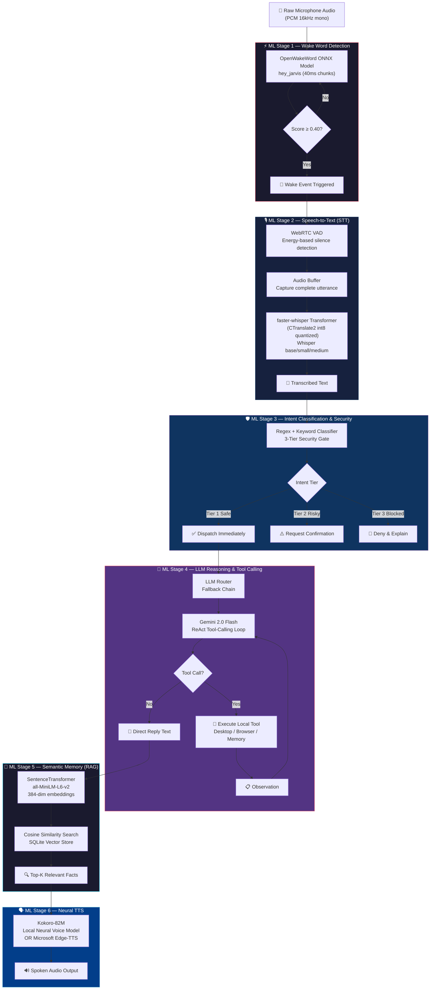

---

### 🔬 ML Stage 1: Wake Word Detection

**Model:** OpenWakeWord (`hey_jarvis` ONNX) + SpeechRecognition fallback

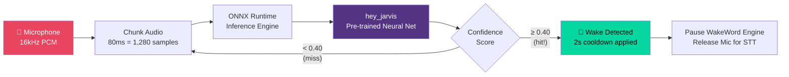

| Property | Value |
|---|---|
| **Audio Sample Rate** | 16,000 Hz |
| **Chunk Size** | 80 ms = 1,280 samples |
| **Model Type** | Pre-trained ONNX Neural Network |
| **Confidence Threshold** | ≥ 0.40 |
| **Cooldown After Detection** | 2 seconds |
| **CPU Usage at Idle** | < 1% (daemon thread) |
| **Fallback** | Google SpeechRecognition + keyword regex matching |

**How the ONNX model works:**
1. Raw audio frames at 16kHz are sliced into 80ms overlapping chunks.
2. Each chunk is passed through the pre-trained `hey_jarvis` neural net via ONNX Runtime.
3. The model outputs a probability score (0.0–1.0) for the target phrase.
4. When score ≥ threshold, the wake event fires and the microphone is handed to the STT engine.
5. A 2-second cooldown prevents the same phrase re-triggering the pipeline.

**Fallback Algorithm (SpeechRecognition):**
When OpenWakeWord is unavailable, a background listener calls Google STT and runs phonetic regex matching. Names like `Sam` get expanded into alias lists (`sharma`, `shama`, `swayam`, etc.) to handle Indian-accent STT transcription errors.

---

### 🎙️ ML Stage 2: Speech-to-Text (STT) — faster-whisper

**Model:** OpenAI Whisper (CTranslate2 quantized, int8)

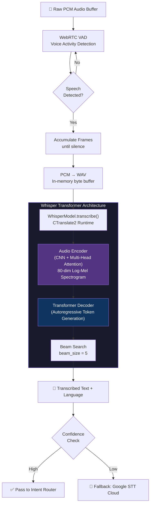

**Whisper Model Sizes Available:**

| Model | Parameters | VRAM | Speed | Accuracy |
|---|---|---|---|---|
| `tiny` | 39M | ~1 GB | Fastest | Basic |
| `base` ✅ | 74M | ~1 GB | Fast | Good |
| `small` | 244M | ~2 GB | Medium | Better |
| `medium` | 769M | ~5 GB | Slow | Great |
| `large-v3` | 1550M | ~10 GB | Slowest | Best |

**How Whisper Works Internally:**

1. **Log-Mel Spectrogram**: Raw PCM audio → 80 frequency bins × time frames using Short-Time Fourier Transform (STFT). This converts the waveform into a 2D image that the neural net can process.

2. **CNN Encoder**: Two convolutional layers extract local temporal features from the spectrogram, converting it to a dense representation.

3. **Multi-Head Self-Attention**: Transformer encoder layers learn long-range dependencies across the full utterance — which parts of the audio are related to which.

4. **Autoregressive Decoder**: Token by token, the decoder generates transcribed text. Each new token attends to all encoder outputs (cross-attention) and all previously generated tokens (causal self-attention).

5. **Beam Search (k=5)**: Instead of greedily picking the highest-probability next token, the decoder keeps the top-5 partial sequences at each step, selecting the globally best sequence at the end.

6. **CTranslate2 int8 Quantization**: Model weights are quantized from 32-bit float to 8-bit integer, making inference ~4x faster on CPU with minimal accuracy loss.

---

### 🤖 ML Stage 3: LLM Router — Multi-Backend Fallback

**Algorithm:** Priority-ordered async fallback chain with 4 backends

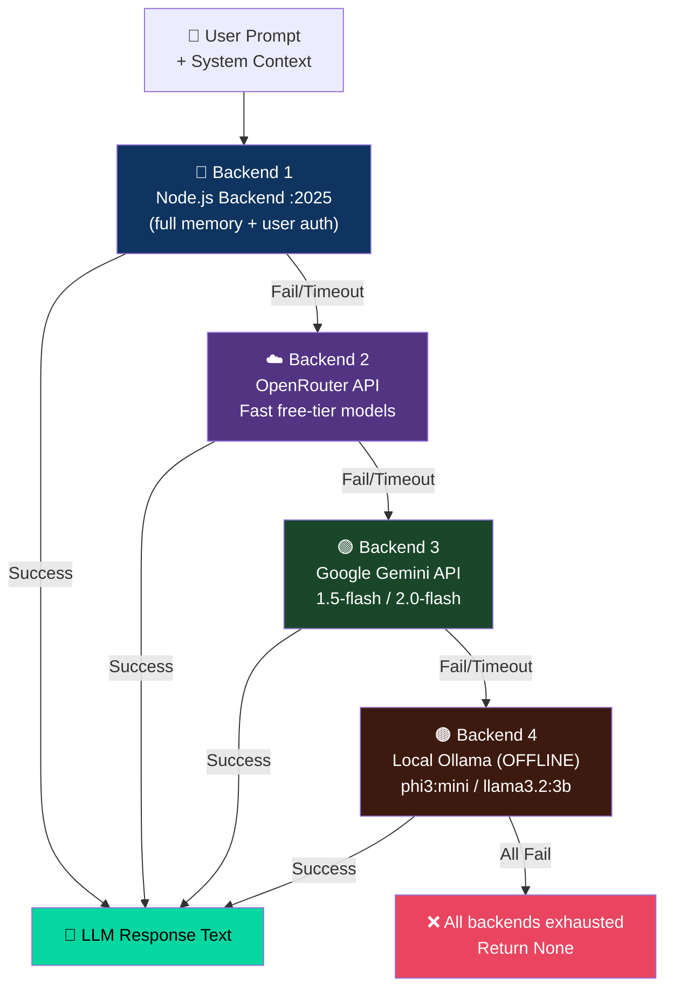

**LLM Parameters Used:**

| Parameter | Value | Purpose |
|---|---|---|
| `temperature` | 0.75 | Creativity/randomness balance |
| `max_tokens` | 300 | Response length cap |
| `timeout` | 20s (cloud) / 60s (Ollama) | Per-backend deadline |
| `beam_size` (Ollama) | Model default | Quality of local generation |

---

### 🤖 ML Stage 4: ReAct (Reason + Act) Agent Loop

**Architecture:** Gemini 2.0 Flash with Function Calling + Local Tool Dispatch

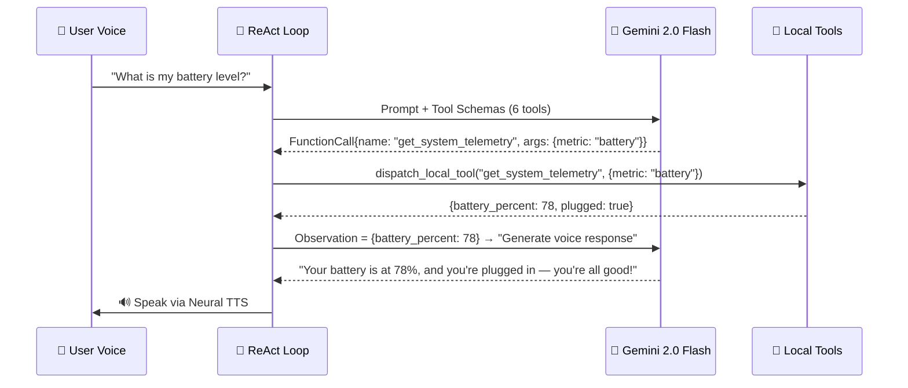

**Tool Schema Pattern (Function Calling):**

```json
{
  "name": "control_volume",
  "description": "Adjust or query the master system audio volume on Windows.",
  "parameters": {
    "type": "OBJECT",
    "properties": {
      "action": { "type": "STRING", "enum": ["set","mute","unmute","increase","decrease","get"] },
      "level":  { "type": "INTEGER", "description": "Volume 0-100" }
    },
    "required": ["action"]
  }
}
```

**Available ReAct Tools:**

| Tool | Function | ML/AI Used |
|---|---|---|
| `control_volume` | Win32 pycaw audio API | Deterministic |
| `launch_app` / `close_app` | Process manager | Deterministic |
| `manage_window` | Win32 window snap | Deterministic |
| `get_system_telemetry` | psutil metrics | Deterministic |
| `inspect_screen_vision` | Screenshot + Gemini Vision | Multimodal LLM |
| `search_web` | DuckDuckGo + BeautifulSoup | Web scraping |

---

### 🧬 ML Stage 5: Semantic Memory — Sentence Transformers + Vector Search

**Model:** `all-MiniLM-L6-v2` (22M parameters, 384-dimensional embeddings)

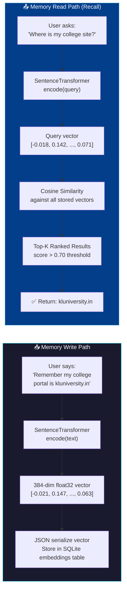

**How Sentence Transformers Work:**

1. **Tokenization**: Text is split into WordPiece tokens (e.g., `"college portal"` → `["college", "port", "##al"]`).
2. **BERT Encoder**: 6 transformer layers with multi-head self-attention create contextual token representations.
3. **Mean Pooling**: Token embeddings are averaged across all positions → one 384-dimensional sentence vector.
4. **Cosine Similarity Search**: The dot product of two L2-normalized vectors, giving a score from –1 to +1 (higher = more semantically similar).

$$\text{similarity}(A, B) = \frac{A \cdot B}{\|A\| \cdot \|B\|}$$

**Memory Tables (SQLite):**

| Table | Purpose | Semantic Search |
|---|---|---|
| `preferences` | User settings, habits | ✅ Yes |
| `contacts` | Name → phone/email | ✅ Yes |
| `shortcuts` | Phrase → URL mapping | ✅ Yes |
| `interaction_log` | Voice command history | No |
| `embeddings` | Shared vector cache | — |

---

### 📂 ML Stage 5b: Notes RAG Indexer (V20)

**Pipeline:** Chunk → Embed → Store → Semantic Retrieve

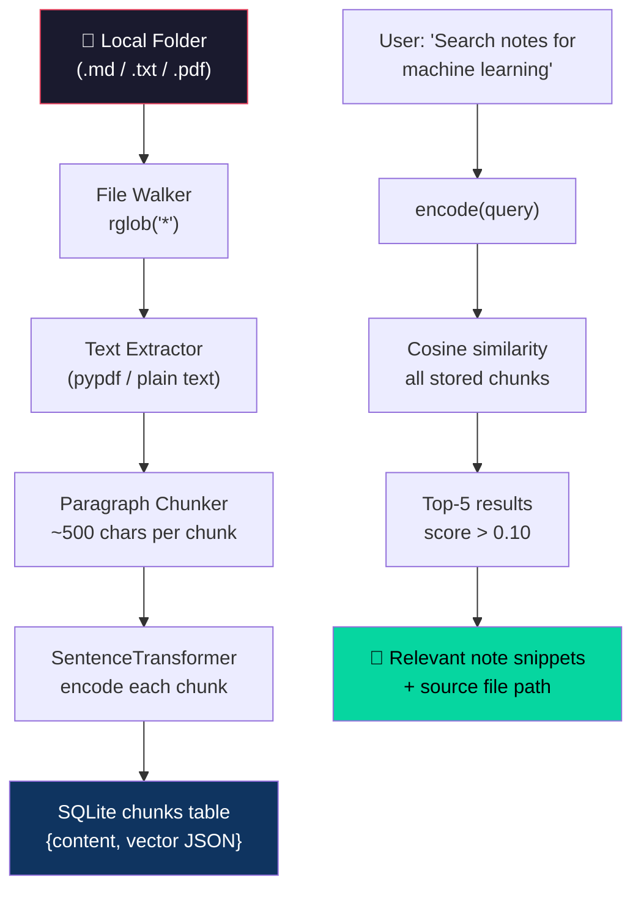

**RAG (Retrieval-Augmented Generation) Architecture:**
- Documents are pre-processed and stored as semantic vectors.
- At query time, the user's question is embedded and compared against all document chunks using cosine similarity.
- The most relevant chunks are returned and injected into the LLM prompt as context.
- This lets Cheeni answer questions about your personal notes **without hallucinating** — answers are grounded in actual document content.

---

### 🗣️ ML Stage 6: Neural Text-to-Speech

**Primary Model:** Kokoro-82M (Local)  |  **Fallback:** Microsoft Edge-TTS (Cloud)

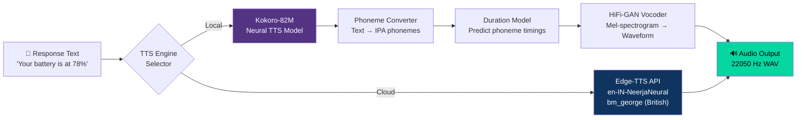

**Kokoro-82M Architecture:**
- **82M parameters** — small enough for real-time CPU inference.
- Uses a **duration model** to predict how long each phoneme should be spoken.
- **HiFi-GAN vocoder** generates the final audio waveform from a Mel spectrogram.
- Supports multiple voice presets: `bm_george` (British male), `af_heart` (American female), and others.
- Average latency: **~400ms** for a typical sentence.

---

### 🏗️ Full ML Architecture — All Models at a Glance

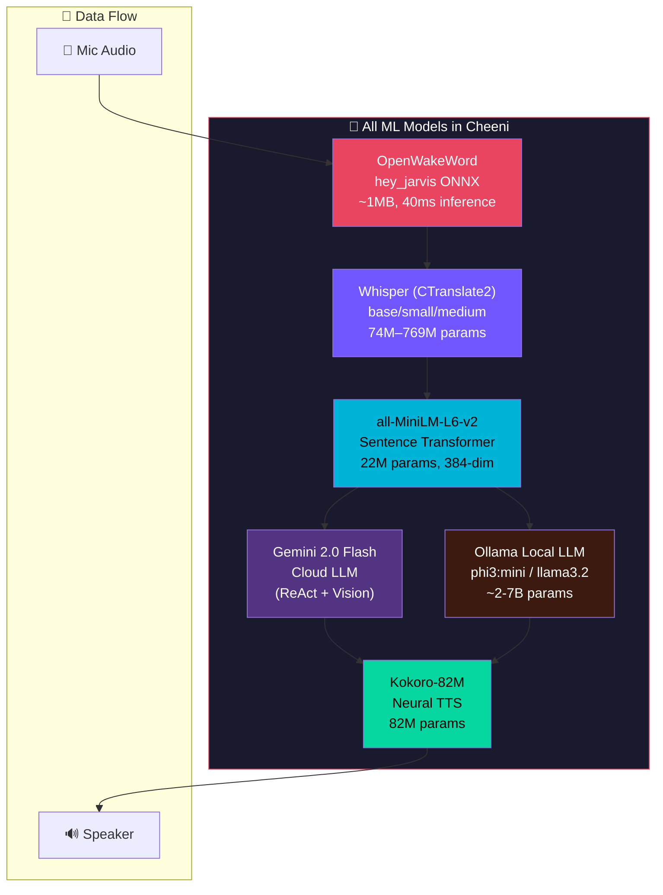

---

### ⚡ ML Performance Benchmarks

| ML Component | Model | Latency | Runs On |
|---|---|---|---|
| Wake Word Detection | OpenWakeWord ONNX | < 10ms/chunk | CPU (< 1% idle) |
| Speech-to-Text | faster-whisper base | ~800ms | CPU int8 |
| Semantic Embedding | all-MiniLM-L6-v2 | < 20ms/query | CPU |
| Memory Recall (top-5) | Cosine similarity | < 80ms | CPU |
| Notes RAG Search | Cosine similarity | < 100ms | CPU |
| LLM Response (cloud) | Gemini / OpenRouter | ~1-2s | Cloud |
| LLM Response (local) | Ollama phi3:mini | ~3-8s | CPU (varies) |
| TTS Synthesis (local) | Kokoro-82M | ~400ms | CPU |
| TTS Synthesis (cloud) | Edge-TTS | ~600ms | Cloud API |
| Screen Vision | Gemini 2.0 Flash | ~1.5s | Cloud |

---

### 🔄 End-to-End Voice Interaction — Step by Step

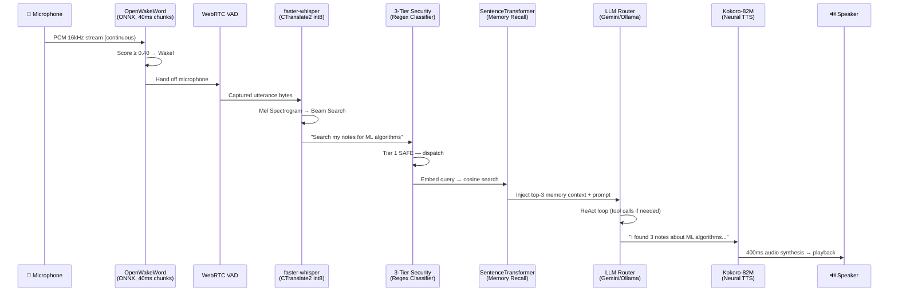

---

<a id="system-architecture--diagrams"></a>
## 📊 System Architecture & Diagrams

### 1. Multi-Tier Distributed Ecosystem

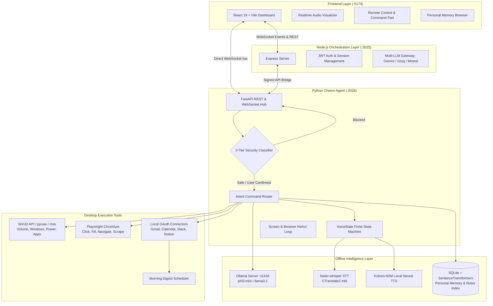

---

### 2. Conversational Voice Pipeline

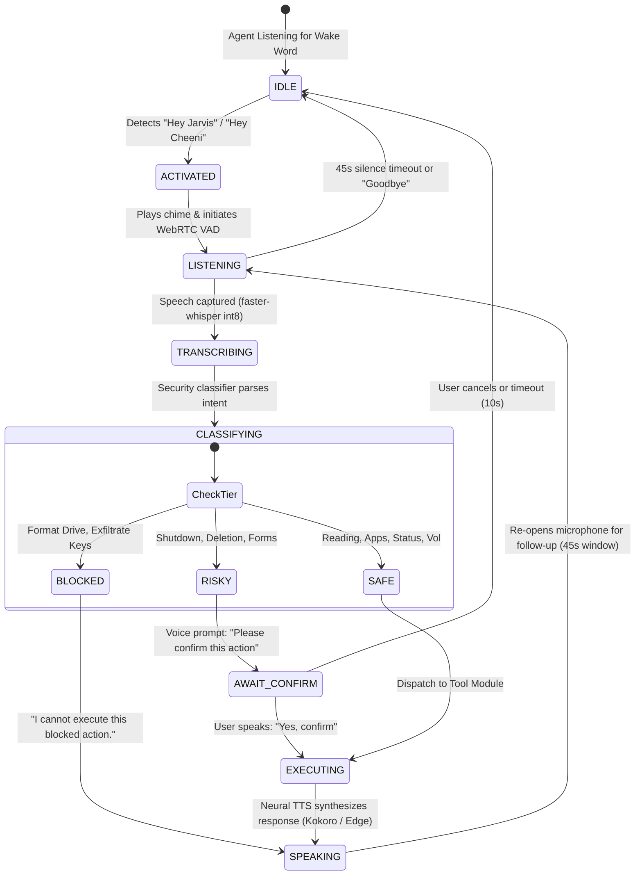

---

### 3. Morning Brief & Connector Aggregation Pipeline

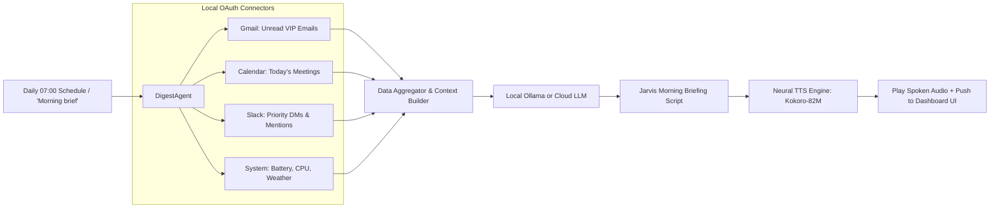

---

## ⚡ Complete 20-Phase Capability Matrix

| Phase | Module | Capabilities & Technology Stack | Latency | Local / Cloud |
| :--- | :--- | :--- | :--- | :--- |
| **V1** | `tools/app_control.py` | Launch, kill, and focus any Windows application (Chrome, Notepad, VS Code). | < 200ms | 100% Local |
| **V2** | `core/server.py` | FastAPI asynchronous REST bridge with Bearer auth and Pydantic v2 schemas. | < 50ms | 100% Local |
| **V3** | `tools/system_status.py` | Battery, CPU, RAM metrics, master audio volume (`pycaw`), lock, sleep, shutdown. | < 100ms | 100% Local |
| **V4** | `tools/file_operations.py` | Sandboxed search & parsing for `.pdf`, `.docx`, `.txt` in Desktop/Docs/Downloads. | < 300ms | 100% Local |
| **V5** | `tools/web_intelligence.py` | DuckDuckGo search, real-time news aggregation, web page scraping with BeautifulSoup4. | ~1.2s | Cloud Search |
| **V6** | `voice/wakeword.py` | Ultra-low power wake word detection (`openwakeword`, ONNX `hey_jarvis` model). | < 50ms | 100% Local |
| **V7** | `tools/window_control.py` | Minimize, maximize, restore, split-screen snap (left/right/top/bottom), virtual desktops. | < 150ms | 100% Local |
| **V8** | `tools/desktop_vision.py` | Multi-screen capture (`mss`), image compression, and Google Gemini 2.0 Flash Vision. | ~1.5s | Hybrid |
| **V9** | `voice/conversation.py` | Full duplex 2-way conversation loop with WebRTC VAD and session memory. | Realtime | 100% Local |
| **V10** | `voice/whisper_listener.py` | `faster-whisper` transformer STT (CTranslate2 int8) for noise-tolerant transcription. | ~0.8s | 100% Local |
| **V11** | `tools/browser_agent.py` | Playwright browser automation (navigate, click elements, fill forms, extract text). | ~1.0s | 100% Local |
| **V12** | `tools/screen_agent.py` | ReAct vision loop (observe ➔ plan ➔ act) with UI element grounding and click automation. | ~2.5s/step | Hybrid |
| **V13** | `voice/edge_speaker.py` | Microsoft Edge neural TTS with sentiment tone modulation (neutral, excited, calm, stern). | ~600ms | Cloud API |
| **V14** | `core/llm_router.py` | Offline LLM router with fallback chain: Node.js ➔ OpenRouter ➔ Gemini ➔ Ollama. | ~2.0s | 100% Local |
| **V15** | `core/personal_memory.py` | Persistent SQLite memory with `all-MiniLM-L6-v2` semantic vector search. | < 80ms | 100% Local |
| **V16** | `frontend/AgentDashboard.jsx` | React 19 glassmorphism dashboard with WebSocket telemetry, memory manager & remote pad. | Realtime | 100% Local |
| **V17** | `tools/digest_agent.py` | Automated morning briefing engine reading Gmail, Calendar, Slack, and system status. | ~3.0s | Hybrid |
| **V18** | `tools/connectors.py` | Local-first OAuth2 connectors for Gmail, Google Calendar, Slack, and Notion. | < 500ms | Local Auth |
| **V19** | `voice/kokoro_speaker.py` | Kokoro-82M local neural voice generator (Jarvis British `bm_george` and American voices). | ~400ms | 100% Local |
| **V20** | `tools/notes_indexer.py` | Semantic RAG vector indexer for personal `.md`, `.txt`, `.pdf` note directories. | < 100ms | 100% Local |

---

<a id="openjarvis-zero-rupee-setup-guide"></a>
## 🚀 OpenJarvis Zero-Rupee Setup Guide

Build your own JARVIS on your laptop in 5 simple steps with zero rupees and 100% open-source software.

### Step 1: Install Dependencies

```powershell
# 1. Clone repository
git clone https://github.com/wraith-klu/Cheeni.git
cd Cheeni

# 2. Python agent setup
cd cheeni-agent
python -m venv venv
.\venv\Scripts\Activate.ps1
pip install -r requirements.txt
playwright install chromium
```

### Step 2: Run a Local Model with Ollama

1. Download Ollama from [ollama.ai](https://ollama.ai) and start it.

2. Pull a fast local model:

   ```bash
   ollama run phi3:mini
   # Or for high-capacity laptops:
   ollama run llama3.2:3b
   ```

### Step 3: Give It a Voice

Configure your `cheeni-agent/.env` to use the offline neural stack:

```env
WAKE_WORD_ENGINE=openwakeword
WAKE_WORD_MODEL=hey_jarvis
WHISPER_MODEL_SIZE=base
WHISPER_DEVICE=cpu
WHISPER_COMPUTE_TYPE=int8
TTS_ENGINE=kokoro
KOKORO_VOICE=bm_george
KOKORO_SPEED=1.05
```

### Step 4: Connect Your Tools (Gmail, Calendar, Slack, Notion)

Trigger local OAuth in your terminal:

```bash
# Link Google Workspace (Gmail + Calendar)
curl -X POST http://localhost:2026/api/connectors/connect -H "Content-Type: application/json" -d '{"service":"gdrive"}'
```

*Your browser will launch Google's OAuth consent screen. Credentials are saved locally on your laptop in `data/connectors/`.*

### Step 5: Schedule Your Morning Briefing

Set your daily morning briefing for 7:00 AM:

```bash
curl -X POST http://localhost:2026/api/digest/schedule -H "Content-Type: application/json" -d '{"time":"07:00"}'
```

Every morning at 7:00 AM, Jarvis will address you by name, summarize your urgent emails, lay out today's schedule, and provide system stats.

---

<a id="getting-started"></a>
## 🛠️ Getting Started

### Prerequisites

- **OS**: Windows 10 or 11 (64-bit)
- **Node.js**: v18.0 or higher
- **Python**: 3.10 or 3.11
- **MongoDB**: Local instance or free MongoDB Atlas cluster

---

### Environment Configuration

#### 1. Node.js Backend (`backend/.env`)

```env
PORT=2025
MONGODB_URI=mongodb://localhost:27017/cheeni
JWT_SECRET=your_super_secret_jwt_key
AGENT_API_TOKEN=cheeni_secret_token_32_characters_long_min
GEMINI_API_KEY=your_gemini_api_key
GROQ_API_KEY=your_groq_api_key
MISTRAL_API_KEY=your_mistral_api_key
```

#### 2. Python Agent (`cheeni-agent/.env`)

```env
PORT=2026
AGENT_NAME=Sam
AGENT_API_TOKEN=cheeni_secret_token_32_characters_long_min
BACKEND_URL=http://localhost:2025

# Offline LLM
OLLAMA_HOST=http://localhost:11434
OLLAMA_MODEL=phi3:mini
OLLAMA_ENABLED=true

# Voice Pipeline
WAKE_WORD_ENGINE=openwakeword
WHISPER_MODEL_SIZE=base
WHISPER_DEVICE=cpu
WHISPER_COMPUTE_TYPE=int8
TTS_ENGINE=edge
EDGE_VOICE=en-IN-NeerjaNeural

# Digest Configuration
DIGEST_TIMEZONE=Asia/Kolkata
DIGEST_HONORIFIC=sir
DIGEST_SECTIONS=calendar,gmail,system
```

#### 3. React Frontend (`frontend/.env`)

```env
VITE_BACKEND_URL=http://localhost:2025
VITE_AGENT_URL=http://localhost:2026
VITE_AGENT_WS_URL=ws://localhost:2026/ws
```

---

### Launching the System

#### Option A: One-Click Windows Launch Script

Double-click `start_cheeni.bat` in the project root to start all 3 services simultaneously.

#### Option B: Manual Terminal Execution

```powershell
# Terminal 1: Node.js Backend
cd backend
npm run dev

# Terminal 2: Cheeni Python Agent
cd cheeni-agent
.\venv\Scripts\Activate.ps1
python main.py

# Terminal 3: Vite React Frontend
cd frontend
npm run dev
```

Visit **`http://localhost:5173`** for the main dashboard and **`http://localhost:5173/agent`** for the JARVIS Remote Control Center.

---

<a id="voice-interaction--commands"></a>
## 🗣️ Voice Interaction & Commands

### Wake Word Phrases

The system continuously listens in low-power background mode:

- *"Hey Jarvis"* / *"Hey Sam"* / *"Hi Cheeni"* / *"Wake up Sam"* / *"Suno Cheeni"*

### Example Voice Commands

#### System & Volume

- *"Set volume to 50 percent"*
- *"Mute sound"* / *"Unmute"*
- *"Check my battery and CPU usage"*
- *"Lock my computer"* (Tier 1 Safe)
- *"Shut down my laptop"* (Tier 2 Risky ➔ Prompts for verbal confirmation)

#### Window Management & Tiling

- *"Snap this window to the left"*
- *"Split screen right"*
- *"Maximize this window"* / *"Minimize everything"*
- *"Switch to the next desktop"*

#### Screen Vision & GUI Interaction

- *"Look at my screen and explain what error is showing"*
- *"Click on the Save button in Notepad"*
- *"Type 'Cheeni AI is live' in the text field"*

#### Browser Automation

- *"Open YouTube and search for lofi music"*
- *"Navigate to github.com and check notifications"*

#### Morning Brief & Personal Memory

- *"Jarvis, give me my morning brief"*
- *"What's on my calendar today?"*
- *"Remember that my college portal is kluniversity.in"*
- *"Where is my college portal?"*
- *"Search my notes for machine learning algorithms"*

---

<a id="3-tier-execution-security-guard"></a>
## 🛡️ 3-Tier Execution Security Guard

Cheeni enforces a strict gatekeeper (`cheeni-agent/security/command_security.py`) to prevent unauthorized or destructive operations:

```text
┌────────────────────────────────────────────────────────────────────────┐
│                        3-TIER SECURITY POLICY                          │
├────────────────────────────────────────────────────────────────────────┤
│ 🟢 TIER 1 - SAFE (Executes Immediately)                                │
│   • Opening registered applications (Notepad, Chrome, VS Code)         │
│   • Adjusting master volume, muting/unmuting                           │
│   • Reading CPU, RAM, battery, datetime metrics                        │
│   • Window snapping, minimizing, maximizing                            │
│   • Reading approved document directories (Desktop/Documents)          │
│   • Speaking morning briefs, playing music                             │
├────────────────────────────────────────────────────────────────────────┤
│ 🟡 TIER 2 - RISKY (Requires Explicit Verbal or UI Confirmation)        │
│   • Shutting down, restarting, or sleeping the computer               │
│   • Deleting, moving, or renaming local files                          │
│   • Submitting online forms or clicking checkout buttons               │
│   • Sending emails or dispatching Slack messages                       │
├────────────────────────────────────────────────────────────────────────┤
│ 🔴 TIER 3 - BLOCKED (Permanently Denied)                               │
│   • Formatting disks or executing destructive diskpart commands        │
│   • Accessing SSH private keys or Windows password vaults              │
│   • Unauthorized fund transfers or crypto transactions                │
└────────────────────────────────────────────────────────────────────────┘
```

---

<a id="verification--testing-suite"></a>
## 🧪 Verification & Testing Suite

Cheeni includes a comprehensive test suite covering all modules:

```powershell
cd cheeni-agent
.\venv\Scripts\Activate.ps1
pytest tests/test_v17_v18_v19_v20.py -v
```

```text
======================= 35 passed in 59.29s =======================
✅ TestV17MorningDigest: Singleton, status, cron scheduling, text brief
✅ TestV18Connectors: OAuth registry, Gmail/Calendar/Slack/Notion mocks
✅ TestV19KokoroTTS: Local neural speaker, speed clamps, voice presets
✅ TestV20NotesIndexer: Directory chunking, SQLite vector storage, RAG search
✅ TestV17_V20_ServerRoutes: FastAPI route registration & Bearer security
```

---

<a id="technology-stack"></a>
## 🧰 Technology Stack

```text
Client Layer:       React 19, Vite, Tailwind CSS, Lucide React, WebSockets, HTML5 Canvas
Orchestration:      Node.js 18+, Express.js, MongoDB (Mongoose), JWT, Axios
Agent Sidecar:      Python 3.10+, FastAPI, Uvicorn, Pydantic v2, WebSockets
Voice & STT:        openwakeword (ONNX), faster-whisper (CTranslate2), WebRTC VAD
Speech Synthesis:   Kokoro-82M Local Neural TTS, Microsoft Edge-TTS, pyttsx3
Intelligence:       Ollama (phi3, llama3.2), Google Gemini 2.0 Flash, OpenRouter
Automation:         Playwright Chromium, pywin32, pyautogui, pycaw, mss, psutil
Semantic Memory:    SQLite 3, sentence-transformers (all-MiniLM-L6-v2), scikit-learn
Connectors:         Google OAuth2 (Gmail, Calendar), Slack SDK, Notion API
```

---

<a id="project-structure"></a>
## 📂 Project Structure

```text
Cheeni/
├── backend/                      # Node.js Express Orchestrator (:2025)
│   ├── src/controllers/          # Chat, user, and agent controllers
│   ├── src/services/             # Multi-LLM provider connectors
│   └── package.json
│
├── frontend/                     # React 19 + Vite Dashboard (:5173)
│   ├── src/components/           # VoiceVisualizer, SystemStats, ChatWindow
│   ├── src/pages/                # AgentDashboard.jsx (V16 Remote Control UI)
│   └── package.json
│
├── cheeni-agent/                 # Python Desktop Agent Sidecar (:2026)
│   ├── core/
│   │   ├── server.py             # FastAPI REST & WebSocket Server (1500+ lines)
│   │   ├── llm_router.py         # Multi-backend fallback LLM router (V14)
│   │   ├── personal_memory.py    # SQLite + SentenceTransformer memory (V15)
│   │   └── react_agent.py        # ReAct loop tool orchestrator
│   ├── tools/
│   │   ├── router.py             # Central command router & regex parser
│   │   ├── app_control.py        # Process launcher and manager (V1)
│   │   ├── window_control.py     # Win32 window snapping & workspaces (V7)
│   │   ├── system_status.py      # Battery, CPU, RAM & power control (V3)
│   │   ├── volume_control.py     # Pycaw master & per-app audio (V3)
│   │   ├── file_operations.py    # Sandboxed document parsing (V4)
│   │   ├── web_intelligence.py   # DuckDuckGo search & scraping (V5)
│   │   ├── desktop_vision.py     # Multi-screen capture & Gemini Vision (V8)
│   │   ├── screen_agent.py       # GUI ReAct action loop & grounding (V12)
│   │   ├── browser_agent.py      # Playwright browser automation (V11)
│   │   ├── digest_agent.py       # Morning briefing engine (V17)
│   │   ├── connectors.py         # Gmail, Calendar, Slack, Notion OAuth (V18)
│   │   └── notes_indexer.py      # Semantic vector RAG notes indexer (V20)
│   ├── voice/
│   │   ├── wakeword.py           # openwakeword background listener (V6)
│   │   ├── listener.py           # WebRTC VAD + faster-whisper STT (V9/V10)
│   │   ├── edge_speaker.py       # Microsoft Edge neural TTS (V13)
│   │   ├── kokoro_speaker.py     # Kokoro-82M offline neural TTS (V19)
│   │   └── conversation.py       # Full duplex continuous voice loop (V9)
│   ├── security/                 # 3-Tier Security Classifier & Confirmation Manager
│   ├── data/                     # Local SQLite databases & OAuth credentials
│   └── tests/                    # Pytest verification suites
│
├── JARVIS_BUILD_PLAN.md          # 20-Phase Master Specification & Architecture Guide
├── start_cheeni.bat              # One-click Windows multi-service runner
└── README.md
```

---

## 🤝 Contributing

Contributions are warmly welcomed! Please feel free to open a Pull Request or file an issue on GitHub.

1. Fork the Project
2. Create your Feature Branch (`git checkout -b feature/AmazingJarvisFeature`)
3. Commit your Changes (`git commit -m 'Add AmazingJarvisFeature'`)
4. Push to the Branch (`git push origin feature/AmazingJarvisFeature`)
5. Open a Pull Request

---

## 📜 License

Distributed under the **Apache-2.0 License**. See `LICENSE` for more information.

<div align="center">

Built with ❤️ by **[Wraith](https://github.com/wraith-klu)** & the OpenJarvis Community


</div>
