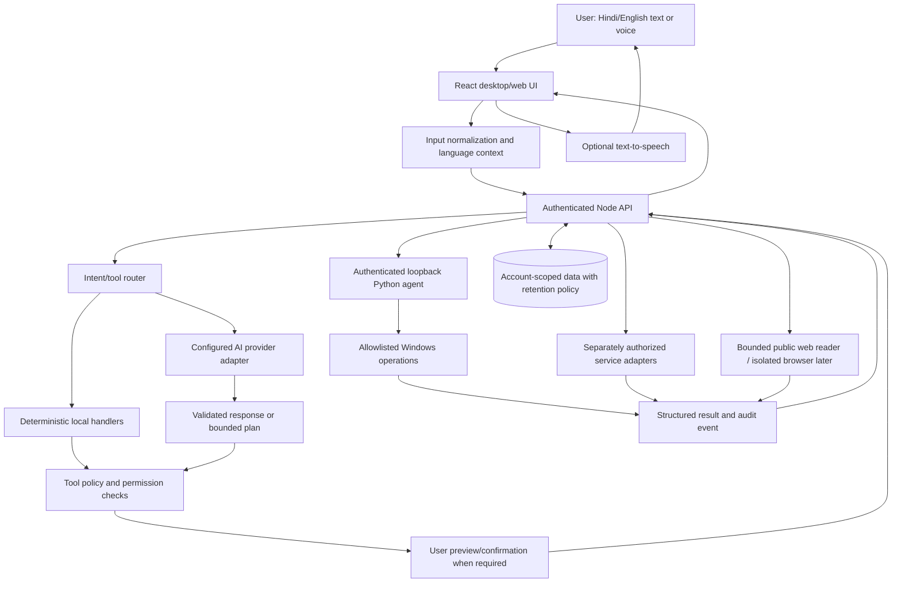

# Cheeni Phase 1 — Product Architecture, Scope, and Decisions

**Status:** Executed as the working architecture baseline; owner review remains required before privacy-sensitive or high-impact feature work  
**Revision:** Re-baseline after Phases 0–15 implementation work  
**Purpose:** Reconfirm what Cheeni should be, how its components should work together, and what safety/privacy constraints govern future development.

> This phase restarts planning, not the repository. Existing code and user changes remain in place. The defaults below are the working architecture for planning and low-risk implementation. They do not claim that every proposed capability is implemented or verified, and they do not authorize enabling sensitive actions, sending private data to a provider, or enabling unattended execution.

## 1. Product Goal

Cheeni is intended to be a personal AI assistant for the owner's Windows computer. The user should be able to type or speak in Hindi or English, ask questions, and request approved actions across apps, websites, files, and eventually selected services. Cheeni should explain what it can do, show plans before meaningful changes, ask for action-specific confirmation where appropriate, and report what actually happened.

The ambition is broad capability—not literal omnipotence. Cheeni must remain bounded by available operating-system permissions, user approval, provider capabilities, network access, and explicit tool policies. It must not treat a language model's output as permission to act.

### Product principles

1. **User-directed:** no hidden tasks, surveillance, or consequential action based on inferred intent.
2. **Local-first for device actions:** device operations execute through a local, authenticated agent; cloud services do not directly control the laptop.
3. **Least privilege:** each tool receives only the access needed for one defined operation.
4. **Visible and stoppable:** proposed actions, permissions, progress, errors, and cancellation state are visible.
5. **Honest capability reporting:** distinguish implemented, partially implemented, unavailable, and unverified behavior.
6. **Language continuity:** respond in the user's language when reliably identified; clarify when language or intent is ambiguous.
7. **Incremental growth:** add one bounded, testable capability at a time rather than granting unrestricted access.

## 2. Requested Capability Landscape

The following is the desired product surface, not a statement of current completion.

| Capability area | Desired outcome | Current baseline / planning note |
| --- | --- | --- |
| Conversation and answers | Ask questions by text or voice; receive useful, appropriately sourced answers. | Existing React chat and backend AI paths exist; provider routing and execution paths need a single approved contract. |
| Hindi and English | Understand both languages and normally answer in the language used by the user. | Browser speech supports language selection and speech response; language auto-detection and native wake-word parity require separate verification. |
| Voice | Push-to-talk first; optionally add a privacy-visible wake word later. | Browser voice and a separate native voice path exist; device-specific reliability and privacy behavior need owner testing. |
| App and website launching | Open approved desktop apps, websites, and known folders; allow user-configured aliases. | A constrained allowlist and alias groundwork exist; configurable aliases and the complete local workflow require review. |
| File operations | Search/read within approved locations; create, rename, move, copy, organize, and back up with preview and recovery. | Search/read and limited single-file mutations exist. Bulk/recursive operations, complete recovery, and delete are not enabled. |
| Browser | Search/read public pages first; later automate one selected workflow in an isolated context. | Public-page reading exists; logged-in automation, form filling, clicking, and submission are not complete. |
| Screen understanding/control | Ask about a consented screen capture; later support one selected visual workflow. | On-demand Q&A is partly wired; general click/type control is not implemented. |
| System actions | Read selected telemetry; later consider carefully bounded settings controls. | Selected read-only telemetry exists; arbitrary scripts, admin access, shutdown/restart, and other high-impact actions are blocked or unavailable. |
| Connected services | Integrate one service and operation at a time using official delegated authorization. | Integration catalog groundwork exists; no connected calendar/email/messaging provider workflow is ready. |
| Reminders and background work | Start with user-visible reminders; later support bounded background scheduling and monitoring. | Browser-local reminders only run while Cheeni is open; no dependable background scheduler is established. |
| Multi-step tasks | Preview an exact plan, request approval, execute bounded steps sequentially, and stop safely. | Task workflow code and automated tests exist. It remains feature-flagged pending owner-controlled Windows testing and acceptance. |
| Memory and personalization | Optional, inspectable, editable, exportable, and deletable preferences. | Conversation history exists; durable inferred assistant memory needs an explicit policy and user controls. |

## 3. Architecture Proposal

### Selected working shape

Retain the existing React frontend, Node/Express backend, MongoDB account/history service, and Python/FastAPI Windows agent for now. Reassess boundaries before replacing components. The Python agent should be the only component that executes Windows operations; Node should authenticate the UI and proxy explicitly authorized requests. AI providers should sit behind a provider-neutral adapter, while deterministic commands should avoid an LLM when practical.

This choice minimizes disruptive rewrites and consolidates policy. It is the working baseline for future phases; implementation must still be reviewed and tested capability by capability.

### Phase 1 decision record

| Decision | Working baseline | Reason / limit |
| --- | --- | --- |
| Initial user/device | One owner on a Windows laptop. | Matches the project and current Python OS agent. Multi-user/device support is not assumed. |
| Primary interface | Keep the React dashboard as the primary interaction surface. | Existing chat/settings/voice UI is already present; defer a native shell until there is a concrete need. |
| Service boundaries | Keep Node/Express for authentication, AI/provider adapters, and UI API; keep Python/FastAPI as the sole Windows action executor. | Avoid a rewrite while consolidating authorization and tool policy. Validate at both backend and agent boundaries. |
| AI mode | Hybrid: deterministic registered local tools for known commands; configured cloud AI for natural-language answers/planning. | Do not claim offline general reasoning. No silent provider fallback; disclose cloud processing and keep sensitive file/screen content local unless separately approved. |
| Hindi and English | Support both. Prefer a response in the language of the user's current message/transcript; ask when ambiguous. Keep an explicit voice input-language choice as the initial reliable input path; test automatic detection before promising it. | Honors the requested same-language reply while matching present browser speech limitations. Code-switching and native wake-word language behavior require device tests. |
| Voice activation | Browser push-to-talk is the default. Native always-on/wake-word listening remains opt-in and deferred. | Always-on microphone access needs separate privacy, reliability, and device review. |
| History and memory | Preserve existing account-scoped conversation history behavior for now; do not introduce new inferred long-term memory. Any future memory must be opt-in and inspectable/editable/deletable. | Conversation history is distinct from durable personalization. Retention/deletion must be made visible before expanding storage. |
| Files and screen data | Process locally by default. Do not forward file content or screenshots to an AI provider unless the UI discloses the destination and the user explicitly requests that operation. | Reduces unintended exposure. Existing app behavior must be verified against this rule before enabling each path. |
| Browser automation | Public-page search/read first. If automation is selected later, use a dedicated Playwright context; do not reuse the user's personal browser profile by default. | Limits access to personal cookies and accounts. Logged-in workflows require a separate decision. |
| Connected services | Add one provider and one operation at a time through official delegated authorization, least privilege, revocation, and clear data disclosure. | The integration catalog is not a connected integration. No email/message sending is authorized by this baseline. |
| Remote device control | No cloud-to-device control relay. Local agent remains loopback-bound and authenticated. | Remote control would need a separate device enrollment, threat model, and approval. |
| Risk policy | No arbitrary shell/code, admin operations, delete, send/submit, purchase, install, shutdown/restart, or unattended consequential action. | These remain disabled until a dedicated reviewed phase and exact action confirmation exist. |
| Distribution | Continue source-run development. Defer installer/autostart until secure token provisioning, lifecycle, updates, logging, and uninstall are designed. | Existing scripts/packages are not proof of a supported release process. |
| Next planning step | Reconcile the existing Phase 2 foundation against this baseline, then choose one small user-visible slice to implement and test. | Phase 1 does not justify redoing or deleting existing code; review current routes and working-tree changes first. |

These are working defaults drawn from the stated project goal and current repository structure. The owner can change them; any change affecting data sharing, microphone/screen capture, connected accounts, destructive actions, or remote access requires an explicit review before implementation.

### Trust boundaries

- The browser UI is not trusted to enforce security by itself. It never receives provider secrets, the agent token, or direct OS execution privileges.
- Node authenticates the user, applies route-level authorization/rate limits, validates the request envelope, and forwards only registered tool calls.
- The local agent independently authenticates the backend request and validates tool schema, target, path, impact, and permissions before touching Windows.
- Tool policy is enforced in code, not solely in a system prompt or model-generated plan.
- External service adapters use separate provider authorization and scopes; provider tokens are not exposed to the frontend, model prompts, or local desktop tool channel.
- Browser pages, files, screenshots, model outputs, search results, and provider responses are untrusted data. Their text cannot change system policy or grant permissions.
- Any future remote-device feature is a separate product/security decision. Do not revive an unauthenticated cloud-to-device bridge as a shortcut.

## 4. Component Responsibilities

| Component | Responsibilities | Explicit exclusions |
| --- | --- | --- |
| React UI | Chat, push-to-talk, language selection, transcript, plan preview, confirmation, progress, settings, and user-visible history. | No API secrets, direct OS calls, or authority to mark an action approved without user input. |
| Node backend | Authentication, request routing, model-provider adapters, user-scoped persistence, rate limiting, task coordination, and authenticated proxy to local agent. | No direct Windows execution and no trust in model-selected tools without validation. |
| Python local agent | Local authentication, registered Windows tools, path/app policy, OS execution, bounded timeouts, cancellation where possible, and result reporting. | No provider credentials, arbitrary model code, unrestricted shell, or cloud-initiated device control. |
| Tool registry | Stable tool IDs, typed schemas, scopes, impact classes, confirmation rules, resource limits, and result schemas. | No free-form tool names or authorization inferred from text. |
| AI provider adapter | Normalize model requests/responses, tool-call schemas, provider errors, timeouts, and usage metadata. | No direct execution, permission decision, or silent provider fallback that changes data-sharing behavior. |
| Web/browser subsystem | Public-page fetch/search under network policy; future isolated browser context for one selected workflow. | No unbounded browsing, credential scraping, silent form submission, or reuse of personal browser sessions by default. |
| Connected-service adapter | One explicitly selected provider operation with least-privilege delegated authorization and revocation. | No broad provider access, plaintext credentials, or implicit send/publish permission. |
| Persistence | Store only necessary account data, task state, and user-approved preferences with explicit retention. | No indefinite retention or hidden inferred memory. |

## 5. Request and Execution Lifecycles

### Conversational question

1. UI obtains text or speech transcript and the selected/detected language context.
2. Backend determines whether the request needs deterministic handling, an AI response, or a registered tool.
3. If a provider is used, disclose/configure what request data may leave the device according to the selected provider setting.
4. Return an answer in the user's language where reasonably clear; disclose uncertainty and provide sources when the answer depends on web data.

### Single desktop action

1. Parse into a registered tool ID and typed arguments.
2. Validate the full request, user/session, target, scope, and impact category.
3. For actions requiring approval, present the exact action and target; approval must be a distinct user action and expire.
4. Revalidate at the Python agent boundary immediately before execution.
5. Return a structured result. A successful HTTP response alone is not proof that an OS action completed.

### Multi-step task

1. Validate and show the complete bounded plan before execution.
2. Bind approval to the authenticated owner and immutable plan digest.
3. Execute one step at a time; revalidate each step and stop on failure, uncertainty, changed assumptions, expiry, or cancellation.
4. Do not auto-retry uncertain side effects or resume after restart without explicit user review.
5. Report verified, failed, not-run, and unknown states accurately. Approval of one plan never approves a changed plan.

### External service or browser write

1. Identify exactly what account/data/website is involved and what leaves the device.
2. Use isolated session credentials and narrow permissions; never ask the AI to handle provider passwords.
3. Preview the exact external write and ask for final action-specific confirmation immediately before submission/sending.
4. Verify the outcome or report uncertainty; do not claim success solely from a click or timeout-free request.

## 6. Permission and Risk Model

| Risk class | Examples | Default policy |
| --- | --- | --- |
| Read-only/local routine | Read selected telemetry, open an allowlisted app/folder, read an approved local text file. | May proceed when specifically requested and within approved scope; disclose data sent externally if any. |
| Bounded lookup | Search the public web or read a validated public page. | Apply URL/network restrictions, size/time bounds, source reporting, and untrusted-content handling. |
| Local mutation | Create a folder, rename/move/copy a file. | Preview exact source/destination/effect and require explicit confirmation; prevent overwrite by default; offer safe recovery when supported. |
| External or consequential | Send messages/email, submit forms, publish, purchase, install, delete, shutdown/restart, or admin action. | Disabled unless a dedicated phase defines exact scope, fresh action-specific confirmation, verification, and recovery. Never infer approval. |
| Prohibited | Credential theft, privilege bypass, arbitrary shell/code, destructive protected-system access, hidden surveillance. | Reject, explain briefly, and do not provide alternate execution paths. |

Approval should be bound to the exact operation, owner, target, and short-lived action state. A change to any material detail requires a new preview and approval.

## 7. Data, Privacy, and Memory Decisions

Before implementation, agree on the following data categories and defaults:

| Data | Proposed default | Decision needed |
| --- | --- | --- |
| Raw voice audio | Do not retain after transcription unless an explicit feature requires it. | Confirm whether any local recording/history is wanted. |
| Transcripts and chat history | Continue existing account-scoped behavior only if wanted; provide deletion/export expectations. | Confirm retention duration and whether sync to backend is acceptable. |
| Files and file contents | Read only on explicit request; keep contents local and out of AI context unless separately disclosed. | Confirm supported file types, maximum size, and provider-sharing behavior. |
| Screenshots | Capture only on explicit request; disclose any provider transmission; do not retain by default. | Confirm whether local screen Q&A is acceptable and which provider may receive an image. |
| Provider credentials | Server-side protected storage for delegated integrations; no prompt/frontend exposure. | Select deployment/key-management approach before connected-service work. |
| Long-term preferences | Opt-in, inspectable, editable, exportable, and deletable; store only necessary facts. | Decide whether to add memory at all, and whether local-only storage is required. |
| Task/operation records | Store minimum state needed for status/recovery; redact sensitive arguments; set expiry. | Confirm retention and user cleanup controls. |

Do not silently change between local and cloud processing. Provider outage or offline mode must not cause broader permissions, an unannounced provider switch, or action execution through a less safe path.

## 8. Technology Direction and Decisions

These are candidates, not locked choices. Verify current compatibility when a concrete phase is approved.

| Area | Existing direction/candidate | Phase 1 decision |
| --- | --- | --- |
| UI | React + Vite dashboard | Confirm primary interface; decide whether a native tray/shell is a later requirement. |
| API/auth | Node.js + Express | Retain or define a migration reason; keep auth and UI-facing API responsibility explicit. |
| Windows agent | Python + FastAPI | Retain as sole OS executor if local agent security and startup lifecycle can be maintained. |
| Database | MongoDB/Mongoose for existing user/history/task data; SQLite used for local operation records. | Define what belongs in cloud/account DB versus device-local DB; define availability without MongoDB. |
| AI | Existing Google/Groq adapters and tool-call code | Pick primary provider, optional fallback policy, data disclosures, model-independent tool contract, and local-model requirements. |
| Speech recognition | Browser Web Speech path; native Python path exists | Choose push-to-talk vs wake word, language auto-detection expectation, offline requirement, and microphone indicator. |
| Speech output | Browser speech synthesis and native TTS path exist | Select default path and fallback; test Hindi/English pronunciation on target hardware. |
| Browser | Public-page reader; Playwright proposed for later isolated automation | Confirm browser automation is in product scope and require dedicated profile by default. |
| Desktop interaction | Typed registered agent tools; screen Q&A exists | Keep general click/type disabled; select one workflow before any interaction executor is designed. |
| Installation | Source-run scripts and packaging/autostart artifacts exist | Defer installer/autostart until updates, token provisioning, startup, logs, and uninstall are designed. |
| Secrets | Environment variables in development | Never commit actual secrets; define secure local provisioning before shipping. |

### Provider fallback rules to decide

- Is the system cloud-first, local-first, or hybrid?
- Is offline functionality required for routine text commands, speech recognition, or both?
- May Cheeni switch providers automatically? If yes, which data may be sent to each provider, and how is the switch shown?
- What is the required behavior when no model/provider is available?
- Can a model plan actions, or should it only parse into a strictly bounded intent schema?

## 9. Capability Boundaries for the Next Milestone

Phase 1 should define the next implementation milestone, not implement it. A safe candidate foundation milestone is:

- One supported text/voice conversation path.
- One language policy for Hindi and English, including behavior when language is ambiguous.
- One authenticated backend-to-local-agent route.
- A small explicitly registered set of low-risk actions.
- A clear user-visible result and connectivity state.
- Tests for authorization, tool schema, invalid targets, timeouts, and no accidental fallback.

Do not include all requested capabilities in one milestone. Keep file mutations, browser automation, screen clicks, service integration, long-term memory, unattended/background tasks, arbitrary scripts, and consequential actions in separate reviewed slices.

## 10. Risks and Required Mitigations

| Risk | Required design response |
| --- | --- |
| Overlapping command/agent paths bypass policy | Inventory each execution route and converge on one authoritative registered-tool gateway; disable/retire unsafe alternate paths only after impact review. |
| Cloud model prompt injection or hostile page/document text | Treat external text as data, use tool allowlists, validate outside the model, and never allow content to modify policy. |
| Localhost mistaken for authentication | Authenticate every local agent request; loopback binding alone is not authorization. |
| Token theft or accidental frontend exposure | Keep agent/provider secrets server-side, rotate/revoke, redact logs, and never send secrets to browser code. |
| Duplicate or uncertain side effects | Use idempotency/state claims where possible; mark ambiguous outcomes unknown and stop instead of retrying. |
| File path traversal, symlink/reparse points, overwrite | Resolve and validate paths at the agent boundary; use approved roots, collision rejection, preview, and recovery journal. |
| Voice misrecognition, especially Hindi/English names | Show transcript, allow correction, clarify ambiguous targets, and require visible confirmation for consequential actions. |
| Screen data leakage | Capture only on demand, make capture visible, minimize retention, and disclose provider transmission. |
| Background task outlives consent | No unattended consequential operations; expose pause/cancel/history and use bounded schedules. |
| Existing experimental code or uncommitted edits are overwritten | Inspect status/diffs before edits; preserve changes; do not clean up files without owner review. |

## 11. Phase 1 Work Plan

1. **Confirm product intent:** who uses Cheeni, which Windows versions/devices, and whether personal/local use is the first supported deployment.
2. **Agree on the primary interface:** dashboard, native app/tray, or both; define voice activation expectations.
3. **Agree on language behavior:** Hindi/English detection, code-switching, voice input choice, response-language rule, and offline expectations.
4. **Agree on component boundaries:** React, Node, Python, databases, AI adapters, and which process is the sole OS executor.
5. **Agree on provider/privacy policy:** cloud vs local/hybrid, provider fallback, data disclosure, retention, and offline behavior.
6. **Agree on authorization policy:** tool registry, permission tiers, confirmation UX, blocked capabilities, and cancellation/uncertainty behavior.
7. **Agree on data ownership:** history, memory, task records, files/screenshots, retention, export, and deletion controls.
8. **Select the next small milestone:** define one user-visible capability and its explicit exclusions.
9. **Record approval:** update this document and `CHEENI_BUILD_PLAN.md`; do not implement the next phase until the owner accepts the decisions needed for it.

## 12. Open Owner Decisions

These are future refinements, not blockers for the low-risk local foundation. Resolve them before the feature they affect is implemented.

- Is Cheeni initially for one Windows user/device, or should multi-user/multi-device use be designed now?
- Should the React dashboard remain the main UI, or is a native Windows app/tray a requirement?
- Should voice be push-to-talk only at first? Is wake-word listening a must-have, and should it work offline?
- Should Hindi/English be auto-detected, explicitly selected, or support both plus code-switching? Which response-language rule do you prefer?
- Which model/provider should be primary? Is a local model required, optional, or out of scope?
- May user text, file excerpts, screenshots, or search context be sent to the selected cloud provider? What should be local-only?
- Should account/history sync remain? What retention and deletion controls are required?
- Do you want durable assistant memory? If yes, which facts, where stored, and what controls are mandatory?
- Which first action family matters most: launcher, files, browser, screen, or a connected service?
- What should be the first user-visible implementation milestone and its success test?
- Should installation/autostart be addressed now or remain deferred until the core workflow is reliable?

## 13. Deliverables

Phase 1 is complete only when the owner has reviewed and approved:

- Product goal, initial user/device target, and explicit non-goals.
- System context diagram and component responsibility boundaries.
- Text/voice request and action-confirmation lifecycle.
- Hindi/English behavior and cloud/local processing policy.
- Permission tiers, confirmation rules, and prohibited actions.
- Data flow, storage, retention, memory, and deletion/export decisions.
- Primary technology direction and provider/fallback policy.
- One bounded next milestone with acceptance tests and exclusions.
- Updated implementation roadmap that does not label deferred or unverified work as complete.

## 14. Acceptance Criteria

- [ ] Owner confirms the product goal and supported user/device scope.
- [ ] Exactly one component is identified as the authoritative Windows action executor.
- [ ] Authentication and validation boundaries are explicit across UI, Node, and Python agent.
- [ ] Cloud/local model behavior, provider fallback, and data-sharing disclosures are decided.
- [ ] Hindi/English voice and response-language behavior is decided, including ambiguity handling.
- [ ] Memory, conversation history, task records, and retention controls are decided.
- [ ] Permission tiers and action-specific confirmation requirements are approved.
- [ ] Existing overlapping or experimental execution paths are inventoried for later disposition; no cleanup is implied by this document.
- [ ] The next milestone is small, measurable, testable, and includes a manual Windows acceptance check where needed.
- [ ] The owner explicitly approves this architecture baseline before further implementation.

## 15. Execution Record and Phase Exit

- Product direction is recorded as a capable, user-directed Windows assistant rather than literal unrestricted autonomy.
- The existing React/Node/Python architecture is retained as the working baseline; no implementation files were changed by Phase 1.
- Hindi/English response behavior, push-to-talk default, local-first treatment of files/screens, and high-impact action exclusions are now explicit planning constraints.
- The next step is a focused Phase 2 foundation audit against this architecture, not blanket reimplementation or cleanup.
- No actual runtime capability was enabled, no secret or live account was used, and no owner-controlled Windows acceptance test was performed as part of this documentation phase.

**Phase 1 exit:** A concrete working architecture and constraints are documented. Before a sensitive capability is implemented, review the relevant open decision and obtain explicit owner approval. The next phase must begin with a current-code audit and one bounded implementation/test slice.

**Next:** Begin Phase 2 by auditing the existing foundation against this baseline. Preserve uncommitted work, avoid cleanup unless specifically reviewed, and do not enable the task-execution feature flag during the audit.
