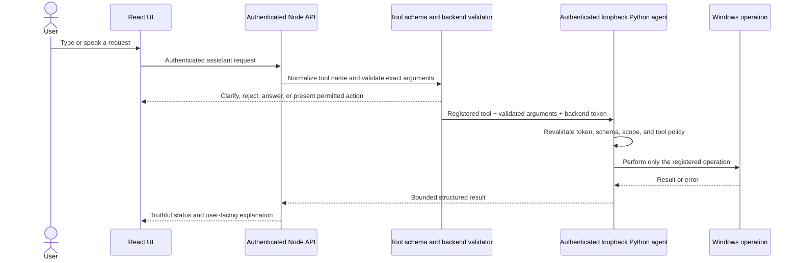

# Cheeni Phase 2 — Secure Command Foundation

**Status:** Code-level hardening implemented; full Phase 2 acceptance remains pending  
**Architecture baseline:** `PHASE_1_ARCHITECTURE.md`  
**Scope:** Re-audit and stabilize the existing typed-command path; do not rebuild completed pieces or remove files as cleanup.

## 1. Purpose

Make a small, predictable set of typed commands work through one authenticated and validated execution path. Establish a dependable foundation for later voice, file, browser, screen, and connected-service capabilities.

Phase 2 is not the phase for broad autonomy. It does not authorize arbitrary commands, general shell access, destructive system operations, or enabling the Phase 15 multi-step execution flag. It focuses on the command contract, safety boundary, error reporting, and target-device verification of the current low-risk tool set.

## 2. Goals

- Use one canonical tool registry and argument/result contract for model-proposed local actions.
- Ensure every model-originated desktop call passes backend validation and independent Python-agent validation.
- Keep the local agent authenticated and bound to loopback; do not rely on localhost as authentication.
- Ensure unsupported or malformed tools fail closed without falling through to a shell, broad legacy endpoint, or alternate executor.
- Support the agreed starter actions: launch an allowlisted app, open a standard folder, open a validated HTTP(S) URL, and read bounded system telemetry.
- Return truthful, structured outcomes for success, invalid request, unsupported capability, unavailable agent, timeout, and uncertain result.
- Show agent availability and the action outcome in the UI; provide cancellation only where the operation can actually be cancelled.
- Add focused automated tests and perform controlled Windows-device checks before declaring this phase complete.

## 3. Non-Goals and Explicitly Deferred Work

- No arbitrary shell, PowerShell, Python, executable path, or model-generated code execution.
- No deletion, overwrite, shutdown, restart, admin operation, process termination, or hidden background action.
- No general-purpose window clicking/typing or screen-control workflow.
- No browser automation, logged-in browsing, form submission, or external send/publish operation.
- No connected-service credentials, OAuth, calendar/email/messaging workflow, or remote laptop control.
- No new durable inferred memory or migration of conversation history.
- No wake-word or always-on microphone changes; Phase 3 owns voice behavior.
- No enabling `TASK_EXECUTION_ENABLED`; Phase 15 remains gated by its own owner-controlled checks.
- No broad refactor, dependency cleanup, deletion, or rewriting unrelated features during this phase.

## 4. Current Baseline to Verify

The roadmap and recent code record a starter implementation with `launch_app`, `open_folder`, `open_url`, and `get_system_telemetry` exposed as the local command subset. The Node desktop-agent adapter validates arguments and sends an authenticated request to the local Python agent. Python agent endpoints use a bearer-token dependency, and the backend has fail-closed tests for several legacy high-impact routes.

This is a repository-reported baseline, not a substitute for checking the current working tree, runtime configuration, actual route wiring, or target Windows behavior. Before editing:

1. Review `git status` and diffs; preserve all existing user changes.
2. Trace one request for each starter tool from frontend/model proposal, through Node, into Python, and back to the UI.
3. Inventory every alternate path that can execute local actions (legacy routes, Python command router/ReAct routes, voice session endpoints, WebSocket/edge bridge, scripts, and direct agent endpoints).
4. Confirm which paths are used, disabled, deprecated, or still reachable. Do not delete or enable them without a reviewed disposition.
5. Confirm agent bind address, CORS policy, token loading, token equality/length, startup process, and the behavior when configuration is missing.
6. Inspect `.env.example` and setup docs only; do not print, copy, commit, or send actual `.env` secrets.
7. Record focused test/build baselines before making changes.

### Starter tool policy

| Tool | Allowed arguments and target | Initial impact | Required validation |
| --- | --- | --- | --- |
| `launch_app` | Canonical app ID from an explicit allowlist; no executable path or extra keys. | Low; opens an approved app. | Exact schema, app ID normalization, allowlist resolution, launch failure reporting. |
| `open_folder` | One known folder alias such as home, desktop, documents, or downloads. | Low; reveals/open a local folder. | Exact alias enum; resolve only the intended known folder; reject arbitrary paths. |
| `open_url` | One absolute HTTP(S) URL, bounded length, no embedded credentials or unsupported scheme. | Low-to-moderate; navigates a browser and may reveal a URL to the default browser. | Parse URL structurally; reject non-HTTP(S), credentials, malformed values, unknown fields, and overlong input. Do not fetch the page in this tool. |
| `get_system_telemetry` | One approved read-only metric from the declared enum. | Read-only. | Exact schema and enum; bounded output; report unavailable metrics without substituting another action. |

The model-visible tool schema, Node validator, Python request model, Python dispatch registry, and UI display must agree. Any disagreement fails closed. A tool is not eligible merely because a legacy route or Python function exists.

## 5. Target Request Flow

The UI may display confirmation or action details, but it is not the security authority. The model cannot mark a request approved. Current starter tools are restricted to low-risk operations; if later policy requires confirmation, implement exact, expiring, user-bound approval in the server/agent path before exposing that tool.

## 6. Command Contract

Each local tool definition must declare:

- Stable tool ID and one-sentence purpose.
- Strict JSON schema, required fields, enums, string/number bounds, and whether unknown fields are rejected.
- Normalized arguments and user-facing description; do not trust model-supplied description text as the approval display.
- Risk class, permitted target/resource scope, and confirmation requirement.
- Timeout, cancellation support, idempotency, and whether a timeout can leave an uncertain result.
- Structured result schema with a success indicator, safe summary, and typed failure category.
- Whether any request/result data leaves the device.

### Result categories

Use stable categories in the backend/UI contract, such as:

| Category | Meaning | UI behavior |
| --- | --- | --- |
| `succeeded` | The local agent returned an expected success result. | State exactly what was opened/read; do not overclaim independent verification. |
| `invalid_request` | Arguments or target did not satisfy the schema/policy. | Explain the allowed form; do not retry through another path. |
| `unsupported` | Tool or capability is not registered/enabled. | Say the capability is unavailable; do not suggest that it ran. |
| `agent_unavailable` | The authenticated local agent cannot be reached or configured. | Show offline/configuration state and a safe next step. |
| `timed_out` | No response arrived within the bound and effect is known not to have started. | Report timeout. Use only when non-execution is known. |
| `outcome_unknown` | Request may have reached the OS but no verified response arrived. | Stop; do not automatically repeat a possibly side-effecting action. |
| `failed` | Agent or OS explicitly reported failure. | Give a sanitized reason; keep secrets and machine-specific sensitive data out of logs. |

Do not use a single generic `success: false` message if it hides a security rejection, unavailable agent, timeout, or uncertain execution. Keep provider errors separate from tool-execution errors.

## 7. Policy and Security Requirements

### Authentication and network boundary

- Python agent listens on loopback by default for this local-only phase.
- Every actionable backend-to-agent endpoint requires the configured bearer token; missing, malformed, or wrong tokens fail closed.
- The browser must never receive the agent token or provider API keys.
- CORS is not authentication. Do not expose the agent on a public interface as part of this phase.
- The Node service must enforce UI authentication and authorize the user before proxying.
- Requests have explicit content-size and timeout limits; errors do not echo secrets or full environment values.

### Tool validation

- Validate model output at the Node boundary and again at the Python boundary.
- Reject unknown tool IDs, extra arguments, wrong types, invalid enum values, overlong strings, malformed URLs, embedded URL credentials, and arbitrary filesystem paths.
- Do not let an invalid tool call fall through to `subprocess(..., shell=True)`, a generic command router, or another legacy executor.
- Use fixed executable discovery/known app mappings; never treat a user/model string as an executable command.
- Do not expand the tool registry based on prompt text or documentation examples alone.

### Privacy and logging

- Avoid recording raw voice audio, file contents, screenshots, tokens, cookies, or full provider request payloads in logs.
- Log request ID, tool ID, status category, latency, and sanitized failure code where useful.
- Keep user-visible errors actionable but generic enough not to disclose secrets, local usernames, or full sensitive paths.
- Disclose when conversational text is sent to a cloud AI provider; do not silently upload files or screenshots.

### Failure and cancellation

- Bound Node-to-agent calls with explicit timeouts.
- Do not claim that a timed-out action definitely failed if the agent may have executed it.
- Do not automatically retry an operation with an uncertain outcome.
- Report cancellation only for an operation with a real cancellation mechanism; otherwise state that cancellation was requested or that the operation completed before it could stop.
- A provider/model failure must not bypass policy or trigger a different executor.

## 8. Implementation Work Packages

### 2.1 — Baseline route and executor audit

- Map frontend/model tool proposals, Node routes/controllers/services, Python routes/dispatchers, and launch scripts.
- Identify primary and alternate execution paths.
- Classify each path `retain`, `disable`, `deprecate`, or `defer`; record reason and tests.
- Verify current failure modes and configuration requirements without printing secrets.
- Preserve existing code until owners review any removal.

**Deliverable:** route/executor inventory and a short disposition table added to this document or a linked audit note.

### 2.2 — Canonical tool contract

- Confirm the four starter tools and exact argument schemas.
- Align model-visible tool definitions, Node validators, Python Pydantic request models, and Python dispatcher.
- Normalize aliases only through an explicit mapping.
- Add structured error categories and sanitized summaries.
- Keep the registry closed by default; unknown tools reject.

**Deliverable:** documented canonical tool schema and focused schema tests.

### 2.3 — Single approved execution path

- Route AI-proposed desktop actions through the authenticated Node-to-agent adapter.
- Ensure normal deterministic commands use the same tool registry/policy boundary where they perform OS actions.
- Disable or make unreachable any alternate execution path that bypasses authentication/policy, only after verifying dependencies and documenting rollback.
- Do not restore the cloud-to-device edge bridge as an alternative execution path.

**Deliverable:** end-to-end route diagram and route tests proving unauthorized, malformed, and unsupported requests never dispatch.

### 2.4 — UI command and status behavior

- Show whether the local agent is connected, unavailable, or not configured.
- Display a human-readable action and target before execution where required by policy.
- Distinguish unsupported actions from invalid arguments and transport failures.
- Preserve transcript and language context, but do not let localization change tool authorization.
- If a result is uncertain, say so and avoid offering an automatic retry button that repeats the side effect.

**Deliverable:** user-visible result-state mapping and interaction tests for the affected components.

### 2.5 — Configuration and startup documentation

- Document the Python agent and Node startup order, health check, loopback URL, token setup, and safe shutdown.
- Provide placeholder-only `.env.example` values and startup validation for missing/weak tokens.
- Do not change actual `.env` files or print their contents during the phase.
- Confirm startup scripts do not launch disabled experimental bridges or unreviewed agents.

**Deliverable:** reproducible developer startup instructions and configuration diagnostics.

### 2.6 — Automated verification

- Test tool schema acceptance/rejection and argument bounds.
- Test UI auth, agent-token auth, and user ownership at the Node boundary.
- Test invalid tool, invalid URL, arbitrary path, unknown field, and shell-like payload rejection.
- Test that disabled/legacy routes fail closed and no alternate dispatch is made.
- Test agent unavailable, malformed agent response, explicit tool error, timeout, and unknown result handling.
- Test redaction for tokens and sensitive values.
- Run the focused test suites, then relevant broader backend/frontend/agent suites.

**Deliverable:** repeatable commands and recorded test outcomes; do not count skipped tests as passing verification.

### 2.7 — Manual Windows verification

Use a controlled session and harmless targets. The owner should be present for any OS-facing test.

- Start Node and the local agent with valid private configuration; confirm both health states.
- Launch an approved harmless app such as Notepad and verify the UI reports the action accurately.
- Open a standard folder and a known safe HTTPS page.
- Read a non-sensitive telemetry metric.
- Try an unsupported app, arbitrary path, malformed URL, extra parameter, and shell-like request; verify no action occurs.
- Stop the local agent and verify the UI reports it unavailable without retrying through another path.
- Use a deliberately invalid/mismatched test token in a controlled test configuration and verify the agent rejects it; never expose the real token.
- Confirm no secret, file content, or screenshot appears in frontend network payloads or logs unexpectedly.
- Restore the normal configuration and close test applications.

**Deliverable:** owner-reviewed manual test checklist with pass/fail notes and any unresolved device-specific limitation.

## 9. Testing Matrix

| Area | Automated coverage | Manual check |
| --- | --- | --- |
| Tool registry | Only four approved tools appear in local model tool subset; unknown tools rejected. | Inspect UI proposal and confirm unsupported action is not dispatched. |
| Arguments | Valid payloads pass; extra keys, wrong types, invalid enums, bounds, paths, schemes, credentials fail. | Try representative malformed requests without real side effects. |
| Authentication | UI endpoint requires app auth; agent endpoint rejects missing/wrong token. | Start local components with a test credential and test unauthorized calls. |
| Alternate paths | Legacy high-impact routes return a fail-closed response and never call the agent. | Confirm experimental bridge/React endpoints are not started by normal scripts. |
| Agent connectivity | Refused connection and timeout map to clear states; no secret is returned. | Stop agent during an ordinary low-risk request. |
| Result truthfulness | Success, explicit failure, malformed response, and uncertain outcome remain distinct. | Verify UI wording corresponds to actual result. |
| Privacy | Logs and responses redact test secrets and do not include raw file/screen data. | Inspect browser network panel and sanitized logs while testing. |
| Windows action | Tool dispatcher uses only allowlisted operation and fixed mapping. | Open Notepad, a standard folder, and a safe HTTPS URL; read one telemetry metric. |

## 10. Acceptance Criteria

- [x] Current working tree, relevant diffs, routes, execution paths, and startup scripts have been audited before edits.
- [x] The four starter tools and exact schemas are documented and consistent across UI/backend/agent.
- [x] One approved authenticated Node-to-Python path handles model-originated Windows actions.
- [x] Python agent binds to loopback by default and independently authenticates every actionable request.
- [x] Model output and deterministic commands cannot invoke arbitrary shell, arbitrary executable paths, or unregistered tools.
- [x] Legacy/experimental paths are explicitly dispositioned and cannot bypass the approved policy path; unmounted bridge code remains deferred, not enabled.
- [x] Errors distinguish invalid, unsupported, unavailable, failed, and uncertain outcomes; timeouts with uncertain dispatch report `outcome_unknown`.
- [x] UI exposes agent connectivity and reports action results without offering a duplicate retry; sensitive payloads are not included in the result display.
- [x] Focused command-boundary, tool-contract, and failure-path tests pass. The broader legacy Python suite still has unrelated failures recorded below.
- [ ] Manual Windows checks pass with harmless targets and owner review; configuration secrets stay private.
- [x] Phase 15 execution remains disabled, and no new high-impact capability is enabled by Phase 2.
- [ ] Startup and troubleshooting documentation matches the tested configuration.

## 11. Rollback and Change Control

- Preserve the pre-phase working tree and do not overwrite unrelated modifications.
- Keep a small, reviewable diff; do not mix unrelated formatting, dependency upgrades, cleanup, or feature work.
- If a route is retired, record its previous behavior, replacement, dependency check, and rollback method before removal.
- Keep high-impact tools disabled if authentication, result truthfulness, or cancellation behavior is uncertain.
- Revert only the specific Phase 2 change if a test reveals a regression; do not reset or clean the whole repository.
- Do not commit unless the owner asks.

## 12. Completion Record

| Work item | Status | Evidence / notes |
| --- | --- | --- |
| Phase 1 architecture baseline | Complete as working baseline | `PHASE_1_ARCHITECTURE.md`; owner review remains needed for privacy-sensitive/high-impact feature work. |
| Initial four-tool subset | Verified in code and mock dispatch | `LOCAL_COMMAND_TOOLS` contains only `launch_app`, `open_folder`, `open_url`, and `get_system_telemetry`; Python route tests use mocked dispatch and do not launch actual apps. |
| Current execution-path inventory | Audited for the supported command boundary | Model desktop calls and alias actions use the Node adapter to authenticated `/api/agent/tool`; Python independently validates the registered tool. Direct UI controls remain separate authenticated fixed-operation routes. The Python `/ws` endpoint rejects direct connections; `/api/agent/react` returns 410. Edge-bridge code and daemon remain present but are not mounted/started by the normal launcher; do not remove or enable them in this phase. |
| Node/Python authentication path | Code-level verified; live proxy unverified | Tool route requires UI auth; Python tool endpoint requires the shared bearer token; default agent host is loopback. The four direct legacy `/api/conversation/*` endpoints now also require the agent token. |
| Alternate/legacy route disposition | Partial | High-impact Node routes already fail closed; ReAct is disabled; conversation routes are protected; direct websocket is rejected. Other authenticated fixed UI routes remain available and are not model tools. Keep the experimental bridge unmounted and the separate daemon stopped. |
| Tool schema and envelope | Hardened | Model-visible starter schemas reject extra argument properties; Node rejects missing/extra top-level envelope fields; Pydantic request rejects unknown fields and bounds tool name; Python validates exact tool arguments before dispatch. |
| Agent startup/microphone policy | Hardened in source; live process not restarted | Agent no longer starts the native speaker or wake-word microphone at startup. Wake-word begins only after explicit authenticated start; stop disables and stops the capture thread. Existing agent process was not restarted because its ownership could not be verified safely. |
| Error and UI outcome reporting | Implemented for the supported action path | Node distinguishes unavailable, unconfigured, rejected, failed, and outcome-unknown results; it never returns malformed agent JSON as success. UI shows the action state and removes the re-execute action chip to avoid accidental duplicate calls. |
| Automated tests | Focused checks pass; broader agent suite is not clean | Backend: `npm test` — 45 passed before the final two focused tests; latest affected suites — 24 passed. Python focused command/Phase 7/Phase 13 suites — 19 passed. Frontend — 27 passed; production build passed with the existing large-chunk warning. A full Python suite run also exposed pre-existing async tests without `pytest-asyncio`, a Phase 4 endpoint test that expects an unauthenticated protected route to succeed, and a network-dependent web-search test that returned no results. |
| Shared-token configuration | Not configured in local `.env` files | Checked only whether values exist and meet minimum length; no secret values were printed. Both backend and agent tokens must be privately configured and match before live proxy tests. |
| Windows manual verification | Blocked / pending owner-controlled run | Port 2026 is occupied by a Python process, but its command line did not establish that it is the Cheeni agent; it was not stopped. Do not send tool requests to it. Configure matching tokens, identify/restart the correct agent, then perform harmless controlled tests with the owner present. |
| Phase acceptance | Pending | Do not declare Phase 2 complete until all applicable acceptance items pass. |

### Changes made during execution

- `backend/services/toolsSchema.js`: closed model-exposed starter tool schemas to unknown arguments and removed the unsupported `terminal` example.
- `backend/services/desktopAgent.service.js` and `backend/routes/agent.routes.js`: classify local-agent failures, distinguish uncertain outcomes, reject malformed tool envelopes, and avoid returning internal transport details.
- `cheeni-agent/core/server.py`: require the agent token on legacy conversation status/start/stop/history endpoints; configure voice callbacks without starting capture; reject extra tool-request fields.
- `cheeni-agent/voice/wakeword.py`: default wake-word state is off; `start()` requires explicit enable; disable stops capture.
- `frontend/src/utils/actionRunner.js`, `frontend/src/pages/Home.jsx`, `frontend/src/components/home/OrbSection.jsx`, and `frontend/src/components/home/CornerCompanion.jsx`: expose action outcomes and remove the action chip's repeat-execution behavior.
- Added regressions in `backend/tests/desktopAgent.service.test.js`, `backend/tests/agentRouteSafety.test.js`, `cheeni-agent/tests/test_phase2_command_boundary.py`, and `frontend/src/utils/actionRunner.test.js`.

### Verification commands

- Backend: run `npm test` from `backend` — 45 passed; 2 Mongo integration tests skipped unless explicitly enabled.
- Python focused: run `python -m pytest tests/test_phase2_command_boundary.py tests/test_phase7_security.py tests/test_phase13_vision_safety.py` from `cheeni-agent` — 19 passed.
- Frontend: run `npm test` from `frontend` — 27 passed.
- Frontend build: run `npm run build` from `frontend` — passed; Vite reports a non-blocking bundle-size warning.

## 13. Phase Exit and Handoff

**Phase 2 exit:** A small, documented command set travels through one authenticated, independently validated execution path; unsupported calls fail closed; the UI reports outcomes truthfully; automated tests and owner-controlled Windows checks pass. If the current foundation already meets an item, verify it and record evidence rather than reimplementing it.

**Next phase:** Phase 3 connects voice to this same command path. Voice recognition must not create a second, less-protected executor. Hindi/English behavior and transcript correction should be tested on the target browser/device before expanding voice scope.
