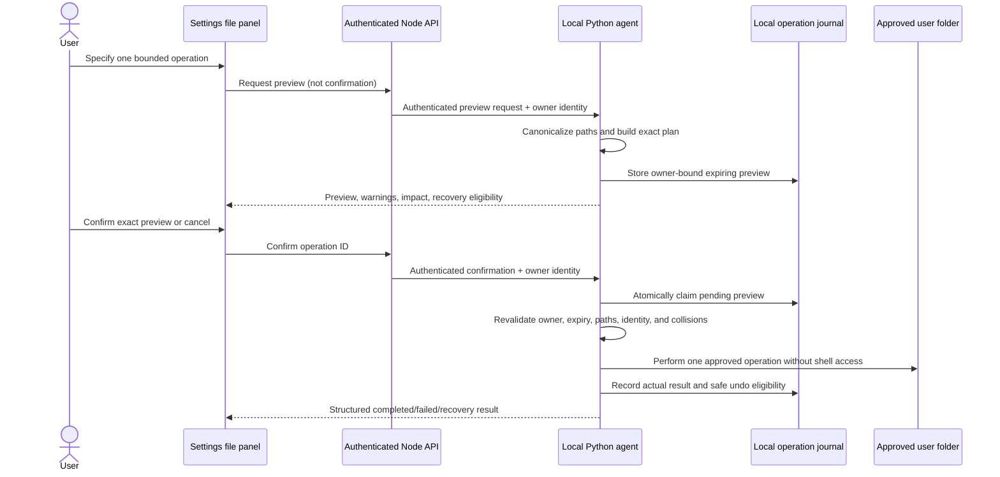

# Cheeni Phase 4 — Safe File and System Actions

**Status:** Single-item preview/confirm workflow and direct-route hardening verified in automated tests; broader workflows and target-device validation pending  
**Prerequisites:** `PHASE_1_ARCHITECTURE.md`, Phase 2 command boundary, Phase 3 voice safety behavior  
**Related detailed design:** `PHASE_11.md` for the preview, journal, recovery, and undo model  
**Scope:** Complete safe, bounded filesystem workflows and add only narrow, observable Windows controls. This phase does not grant general computer administration.

## 1. Purpose

Let Cheeni perform genuinely useful local work—searching approved user folders, reading supported files, creating folders, renaming, moving, copying, backing up, and reporting selected system state—without turning natural-language requests into unrestricted access to the laptop.

Every change must be scoped, previewed, explicitly confirmed, revalidated immediately before execution, journaled, and reported truthfully. A file operation that cannot be safely described, bounded, or recovered must remain unavailable.

## 2. Current Baseline

The repository already provides an owner-scoped, short-lived preview workflow for single-item `create_folder`, `rename`, `move`, and `copy` operations within Desktop, Documents, and Downloads. Preview records are stored locally, expire after five minutes, reject collisions, revalidate file identity before commit, and support a separately confirmed undo preview for safe rename/move cases.

The Settings UI can perform bounded file search/read and show preview, confirm, cancel, refresh, and eligible undo actions. Direct mutation endpoints and legacy free-form command paths fail closed. Delete remains disabled.

This phase validates that implementation on the target Windows device, fixes only discovered safety gaps, and adds the remaining bounded workflows one at a time. It does not assume that implementation evidence replaces actual filesystem testing.

## 3. Goals

- Keep all file reads and changes inside explicitly approved user-data roots.
- Make the exact source, destination, count, collision behavior, estimated size, and recovery status visible before a write occurs.
- Ensure a browser/model cannot alter a server-created plan after preview or reuse another user's preview ID.
- Protect against traversal, symlinks/reparse points, stale files, race conditions, collisions, accidental overwrite, and unsafe cross-volume moves.
- Provide a useful, bounded search/read experience without sending document contents to AI providers by default.
- Add deterministic backup and organization flows only when the full item list is previewed and limited.
- Add read-only or narrowly scoped system controls with honest outcome reporting.
- Retain Hindi/English status text where the current UI supports localization, without allowing language to weaken policy.

## 4. Non-Goals and Hard Boundaries

- No delete, permanent erase, Recycle Bin emptying, cleanup-by-age, or mass deletion.
- No arbitrary path access, drive traversal, network/UNC paths, cloud-sync root access, removable-drive access, registry edits, ACL/permission changes, or elevation.
- No arbitrary shell, PowerShell, Python, batch file, executable path, or model-generated code execution.
- No overwrite, merge, replace, or automatic collision resolution. A collision fails and requires an explicit new workflow design.
- No broad “organize my computer,” fuzzy duplicate detection, inferred categorization, or unreviewed recursive mass move.
- No scheduled/background file mutation or unattended repair.
- No document-content editing, no credentials/secrets handling, and no upload of file contents to an AI provider without a later, specific disclosure and confirmation design.
- No shutdown, restart, software install, admin command, Wi-Fi/Bluetooth configuration, or process/window termination in this phase.

## 5. Permission Model

| Tier | Operation examples | Required behavior |
| --- | --- | --- |
| Read-only | Bounded search, metadata, supported-file read, battery/CPU/RAM status | Execute through an allowlisted endpoint and show the target/result. |
| Reversible change | Create empty folder, rename, same-policy move, one-file copy/backup | Server preview, visible exact plan, explicit confirmation, revalidation, journal, truthful result. |
| Conditionally recoverable | Bounded multi-item copy/move organization | Full itemized preview, strict limits, explicit confirmation, itemized results, safe recovery plan. |
| Consequential | Shutdown/restart, install, admin work, close unsaved work, external send | Disabled here; requires a dedicated future phase and action-specific confirmation. |
| Blocked | Delete, arbitrary commands, protected paths, credential access, override of policy | Reject without alternate fallback. |

Voice input remains subject to Phase 3: voice produces an editable transcript, and it never supplies the confirmation for a file/system change.

## 6. Filesystem Policy

### 6.1 Approved roots

- Resolve the current user's Desktop, Documents, and Downloads directories at the local agent. If an expected root does not exist, report it; never substitute a similarly named path.
- Both source and destination must resolve within an approved root. The phase's initial policy forbids cross-drive moves and targets outside those roots.
- Perform containment checks using canonical resolved paths, never a string-prefix comparison.
- Use Windows case-insensitive semantics when comparing paths, and test Unicode/case collisions on the target device.

### 6.2 Rejected path types

Reject before preview and recheck before commit:

- `..` traversal after canonicalization, drive-relative paths, device paths, UNC/network paths, alternate data streams, reserved device names, environment-variable expansion, and ambiguous `~` expansion.
- Symlinks, junctions, reparse points, mount points, hard-linked files, and special file types for mutations. Read behavior must be equally conservative until specifically verified.
- Root folders as rename/move sources, a directory move into itself or its descendant, and a destination that already exists.
- Any path whose parent changes or escapes its approved root after preview.

### 6.3 Read/search policy

- Search is limited by root, depth, visited paths, result count, and execution time.
- File reads use a strict supported-extension/type allowlist and a maximum input size of 2 MiB unless a later design changes this deliberately.
- Return bounded extracted text and metadata. Reject encrypted, binary, unsupported, unreadable, linked, or changed-while-reading files with a clear explanation.
- Treat file names, metadata, and file content as untrusted data. They cannot change instructions, tools, permissions, or confirmation state.
- Do not route file contents into the conversational model or analytics by default.

## 7. File Operation Lifecycle

### 7.1 Preview record contract

The local agent, not the browser, creates and stores a preview record. It includes:

- Opaque operation ID, authenticated owner ID, creation/expiry time, version, and state.
- Normalized operation type plus exact canonical source, parent, destination, and approved-root classification.
- Item count, estimated bytes, available destination bytes where meaningful, collision policy, warnings, and expected recovery/undo availability.
- Source identity snapshot sufficient for the supported operation (file identity/stat signature and policy checks).
- A plan digest so a client cannot substitute a different target under the same operation ID.

Preview states are `pending`, `executing`, `completed`, `cancelled`, `expired`, `failed`, or `recovery_required`. A preview expires after five minutes by default, belongs to one authenticated owner, is consumed once, and cannot be refreshed silently by retrying a confirm request.

### 7.2 Commit requirements

Before execution, atomically change `pending` to `executing`; concurrent confirmation attempts must not run twice. Revalidate owner, expiry, source identity, destination parent, approved-root containment, reparse/hard-link status, collision policy, capacity, and operation-specific constraints. Any mismatch fails closed and requires a new preview.

The executor uses fixed library calls and resolved paths only—never shell commands. It records a structured result with `succeeded`, `failed`, `cancelled`, `partially_completed`, `rolled_back`, or `recovery_required` as applicable. Timeouts or crashes must never be reported as a confirmed success.

### 7.3 Recovery and undo

- **Create folder:** no automatic undo unless a later verified empty-folder check is added; never remove a folder automatically just because it was created by Cheeni.
- **Rename/move:** offer a new undo preview only while the moved object still has the expected identity and original location remains free.
- **Copy/backup:** preserve the source. Do not offer deletion-based undo until exact-copy identity and user expectations have a separately reviewed design.
- **Partial multi-item workflow:** keep per-item journal outcomes and show precisely what changed. Never run a destructive blanket rollback against files the user may have modified.

## 8. System Control Policy

### 8.1 Allowed initial controls

| Control | Scope | Behavior |
| --- | --- | --- |
| System telemetry | Battery, charging status, bounded CPU/RAM/disk metrics | Read-only, allowlisted metric names, structured result. |
| Volume | Explicit numeric level within 0–100 | User-triggered, bounded, result reports requested/applied level. |
| Approved app/folder/URL launch | Existing Phase 2 allowlists | Continue to use Phase 2 tool registry and result categories. |

### 8.2 Deferred controls

- Brightness, Wi-Fi, Bluetooth, process/window controls, clipboard access, notifications, and scheduled shutdown require separate review of platform APIs, scope, observability, and recovery.
- Any command that may lose work, change security state, disconnect networking, or alter power state is consequential and stays disabled.
- The model cannot compose a new system command from natural language. Every control must have a named tool, strict schema, narrow argument range, timeout behavior, and a verified user-facing result.

## 9. Implementation Work Packages

### 4.1 — Validate the existing single-item workflow

1. Trace the Settings panel through Node proxy, Python routes, operation journal, and filesystem executor.
2. Test create-folder, rename, move, and one-file copy in disposable folders under each approved root.
3. Verify expiry, cancellation, owner isolation, replay prevention, identity change rejection, collisions, symlink/hard-link rejection, cross-drive move rejection, and agent-unavailable reporting.
4. Confirm legacy direct-mutation and free-form command routes remain `410` and are not model tools.

**Deliverable:** completed target-device checklist and focused evidence recorded in this document.

### 4.2 — Harden bounded search and reads

1. Confirm path resolution and reparse-point rejection before metadata/read work.
2. Enforce limits for result count, recursion, output bytes, file size, supported format, and request duration.
3. Make unsupported/encrypted/changed-file errors truthful and safe to display.
4. Verify file content never enters model prompts, browser logs, or telemetry without a future opt-in design.

**Deliverable:** repeatable read/search tests with content-redaction checks.

### 4.3 — Improve preview and recovery UX

1. Show exact source, destination, item count, estimated size, expiry, collision policy, and recovery status before confirmation.
2. Localize UI labels/statuses in Hindi and English where current settings support them; paths and operation IDs remain literal.
3. Keep Cancel distinct from Confirm. Disable confirmations for expired/executing/consumed previews.
4. Display itemized result and safe undo offer only when the agent marks it eligible.
5. Add minimal owner-scoped operation history/cleanup only after retention, privacy, and failure behavior are designed.

**Deliverable:** accessible, transparent preview/confirm/result interface.

### 4.4 — Add one bounded backup workflow

1. Start with copying a user-selected file or explicit, bounded list inside approved roots.
2. Show source, destination, bytes, available space, collision behavior, and source-preservation guarantee.
3. Use temporary output plus verification before publishing the final copy; never overwrite.
4. Record every result and leave cleanup of only operation-created temporary files.

**Deliverable:** verified copy-only backup workflow. Do not add archive, sync, cloud, or scheduled backup here.

### 4.5 — Add one deterministic organization workflow only after 4.1–4.4 pass

1. Choose one user-selected rule, such as extension-to-folder, for one explicitly selected source folder.
2. Build a full itemized move/copy list before any change; show skipped files and each destination.
3. Enforce conservative item, byte, depth, and elapsed-time caps.
4. Stop at a safe item boundary on unexpected failure and return per-item recovery information.

**Deliverable:** one reviewed, bounded organization workflow. Do not expose open-ended automatic cleanup.

### 4.6 — Verify narrow system controls

1. Test each allowlisted telemetry metric and volume bound on the target Windows device.
2. Confirm unavailable hardware/permissions report `unsupported` or `failed`, not success.
3. Verify any action result uses Phase 2 structured outcome categories and never falls back to shell execution.

**Deliverable:** device evidence for each enabled system control.

## 10. Testing Matrix

| Area | Automated coverage | Manual target-device check |
| --- | --- | --- |
| Root containment | Traversal, prefix-bypass, case/Unicode edge cases, outside-root destination. | Attempt paths outside Desktop/Documents/Downloads; confirm no access. |
| Link/special-file policy | Symlink, junction, reparse-point, hard-link, device/UNC rejection. | Create safe disposable fixtures and verify rejection. |
| Preview lifecycle | Owner mismatch, expiry, cancel, replay, concurrent confirmation, malformed ID. | Confirm once, refresh, and retry; observe truthful state. |
| Revalidation | Modified/moved source, changed parent, collision after preview, cross-drive move. | Alter fixture between preview and confirm; no mutation should occur. |
| Operations | Folder create, rename, move, copy/backup success and failure. | Use disposable files in each approved root. |
| Recovery | Safe undo eligibility and identity mismatch rejection. | Rename/move then preview undo; change item and verify undo is withheld. |
| Search/read | Size/type/depth/result bounds, malformed/linked files, content redaction. | Read an allowed small file and reject a too-large/unsupported fixture. |
| UI | Preview details, disabled confirm, cancel, result/error localization. | Keyboard-only confirmation/cancel, Hindi and English labels. |
| System controls | Metric enums/ranges, volume bounds, unavailable-agent result. | Validate telemetry and volume on Windows hardware. |
| Legacy paths | Direct mutation/free-form/shell-like payloads fail closed. | Confirm no UI route can bypass preview/confirmation. |

## 11. Manual Acceptance Checklist

Use only disposable folders/files under the approved roots. Never test with important documents.

- [ ] Search returns bounded results only from approved roots.
- [ ] Supported read succeeds for a small disposable document and rejects unsupported/large/linked files.
- [ ] Create-folder preview shows exact parent and destination; Cancel creates nothing.
- [ ] Confirmed create-folder creates only the shown folder and reports the true result.
- [ ] Rename, move, and copy each reject a collision without overwriting anything.
- [ ] Change a source after preview; Confirm rejects it and does not mutate another file.
- [ ] Move across drives, outside roots, into a child folder, or through a reparse point is rejected.
- [ ] A preview expires and cannot be committed later.
- [ ] A preview cannot be confirmed by a different authenticated account.
- [ ] Safe rename/move undo requires a new preview and rejects a changed target.
- [ ] Copy preserves the source and verifies the destination.
- [ ] Agent stop/disconnect during a harmless operation produces a truthful error/uncertain result, not a success claim.
- [ ] Direct mutation, delete, free-form command, and shell-like requests do not produce local side effects.
- [ ] Telemetry/volume controls behave within documented bounds and report unavailable hardware honestly.
- [ ] Hindi and English UI messages remain understandable; no voice phrase alone confirms a mutation.

## 12. Acceptance Criteria

- [x] All enabled file changes use a server-created, owner-bound, expiring preview and explicit confirmation.
- [x] Path containment and special-file policy are enforced by the local agent immediately before preview and commit.
- [x] No operation overwrites data, follows unsafe links, invokes a shell, or falls back to a legacy route.
- [x] Read/search limits and content privacy behavior are covered by focused automated tests.
- [ ] Create-folder, rename, move, and copy pass focused automated tests; disposable-folder manual validation remains open.
- [x] Undo is available only for verified safe rename/move cases and uses its own confirmation preview.
- [ ] Any organization/backup workflow is deterministic, itemized, bounded, and recovery-aware; only the one-file copy baseline is enabled.
- [x] Enabled system controls are narrow, allowlisted, observable, and truthful about failure/unavailability at the API boundary.
- [x] Delete and consequential system operations remain unavailable through the authenticated Node and direct agent routes.

## 13. Rollback and Change Control

- Keep direct mutation routes disabled throughout the phase. If the preview pipeline is uncertain, disable the affected operation rather than adding a bypass.
- Do not broaden approved roots, enable delete, alter collision policy, or add scheduled/background mutation as a quick fix.
- Preserve existing user worktree changes and use disposable fixtures for tests; never clean/reset user folders.
- Revert only the responsible operation/tool/UI change if it violates policy. Preserve journal evidence needed to explain a partial result.
- Do not commit or enable a deferred system control without owner approval.

## 14. Completion Record

Populate during execution.

| Item | Result | Evidence / notes |
| --- | --- | --- |
| Existing single-item route/UI audit | Complete | Settings panel uses preview/confirm/undo routes; direct mutation routes return `410`. |
| Target-device file operation tests | Pending | Use only disposable files/folders in approved roots. |
| Search/read limit and privacy validation | Automated coverage passed | Covered by focused agent file-operation tests; manual device review remains open. |
| Recovery/undo validation | Automated coverage passed | Rename/move undo is an owner-bound fresh preview; manual disposable-folder validation remains open. |
| Bounded backup workflow | One-file copy baseline verified | Copy remains single-file, collision-rejecting, source-preserving, and does not offer destructive undo. |
| Organization workflow | Deferred |  |
| Narrow system-control validation | Automated coverage passed | Authenticated specs/apps/zero-delta volume test retained; physical hardware review remains open. |
| Legacy route fail-closed checks | Passed | Direct app/window termination and lock/sleep/restart/shutdown routes return `410`; Node route-safety suite passed. |
| Focused test record | Passed with one intentional skip | Python: 23 passed, 1 skipped. Frontend file panel: 1 passed. Node route safety: 20 passed. |
