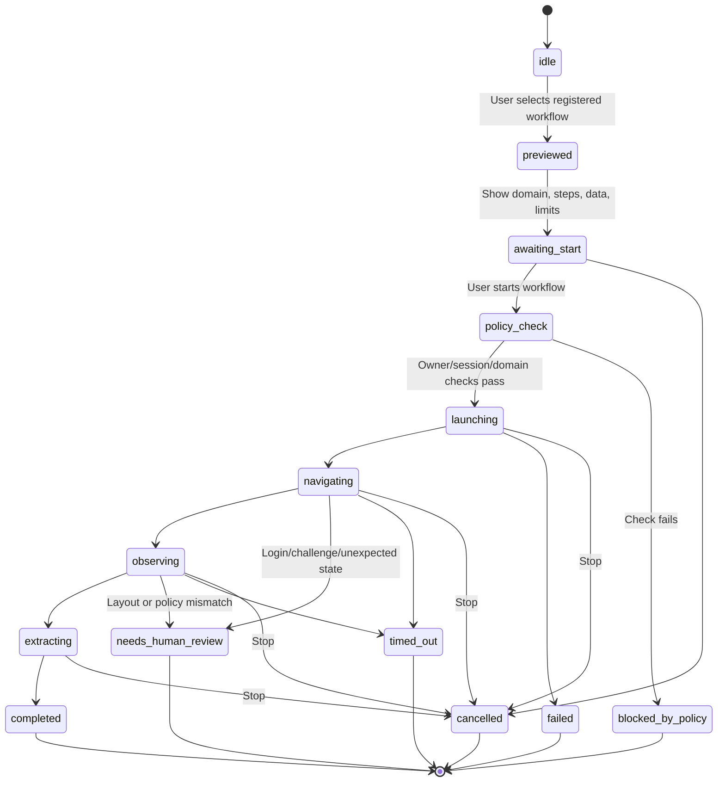

# Cheeni Phase 5 — Controlled Browser Workflows

**Status:** Public-page fetch is hardened; no browser automation, sign-in, download, click, or submission workflow is enabled  
**Prerequisites:** Phase 2 command boundary, Phase 3 interaction safety, Phase 4 confirmation principles  
**Related detailed design:** `PHASE_12.md`  
**Scope:** Safe public-web research now, followed only by one owner-approved, named, preferably read-only browser workflow in an isolated context.

## 1. Purpose

Give Cheeni useful web capability without giving an AI unrestricted control of the user's daily browser, accounts, cookies, or external actions. The browser is treated as an untrusted environment: pages can contain hostile text, unexpected redirects, trackers, login prompts, and instructions designed to change the assistant's behavior.

Phase 5 therefore separates two capabilities:

1. **Public-web research:** search, open safe public URLs, extract bounded page text, and summarize it with source attribution.
2. **Named browser workflow:** a single deterministic workflow, selected by the owner, with fixed domains, inputs, expected page states, limits, progress, stop behavior, and no unreviewed external side effect.

Until the owner selects a workflow contract, browser automation stays disabled. The existing public-page reader may be hardened and tested, but no general browser agent is introduced.

## 2. Current Baseline

The local agent exposes authenticated web search, news, and scrape routes through the Node gateway. The public-page fetcher accepts public HTTP(S) URLs on standard ports, rejects embedded credentials and non-global IP resolutions, does not follow redirects, accepts HTML only, and bounds response/extracted-text size. Page text is not connected to model tools or automatic form actions.

There is no Playwright/Selenium runtime, isolated browser profile, workflow-run store, browser automation UI, signed-in browser access, download/upload handling, click/type capability, or external submission flow. This is intentional—not missing authorization.

## 3. Goals

- Preserve safe, bounded public-page search/read/summarize behavior with source URLs.
- Keep the browser lifecycle behind the authenticated application gateway; the frontend never receives the local agent bearer token.
- Implement at most one registered workflow at a time, and only after owner review of its exact contract.
- Launch one temporary, isolated browser context per run; never attach to the user's ordinary Chrome/Edge profile.
- Enforce URL, DNS, navigation, domain, redirect, timeout, and content-size policy outside the model.
- Make every browser run visible, cancellable, owner-scoped, time-bounded, and truthfully reported.
- Treat page content, labels, OCR, metadata, and browser errors as untrusted data—not instructions or permission.
- Require an action-specific, visible final confirmation for any future external effect.

## 4. Explicit Non-Goals

- No unrestricted browser agent, arbitrary model-generated click/type/selectors, JavaScript injection, DevTools protocol control, or coordinate automation.
- No access to the user's normal browser profile, password store, cookies, saved form values, extensions, history, downloads, or bookmarks.
- No username/password entry, CAPTCHA/MFA bypass, token capture, account creation/changes, or session-cookie storage.
- No file upload/download, payment, purchase, send/publish, messaging, email, form submission, or account setting changes in the initial workflow.
- No private-network, loopback, LAN, metadata-service, device, or unsupported-scheme navigation.
- No browser extensions, stealth/evasion behavior, unattended schedule, background execution, or arbitrary shell command.
- No claim that an inaccessible/login-protected/changed page was read or acted upon successfully.

## 5. Owner Decision Gate

Before any browser runner is added, the owner chooses exactly one first workflow. Cheeni must not choose one automatically from a broad request such as “automate websites.”

The workflow contract must state:

| Field | Required decision |
| --- | --- |
| Name and user goal | A short, user-recognizable read-only task. |
| Inputs | Typed values/URLs and maximum sizes; no credentials. |
| Allowed domains | Exact hostname list, including whether subdomains are allowed. |
| Navigation | Initial URL, allowed same-domain paths, redirect/pop-up policy, and maximum pages. |
| Allowed actions | Deterministic read-only steps using stable page semantics. |
| Output | Bounded facts, extracted fields, and source URLs. |
| Limits | Maximum run time, page count, actions, response bytes, and retry count. |
| Failure behavior | Login, CAPTCHA, changed layout, unexpected domain, timeout, or uncertain state. |
| Data disclosure | What leaves the device, is sent to a provider, is shown to the user, and is retained. |

Recommended first workflows are read-only: summarize a public article URL, compare a small set of public product pages, or report named information from a public page. If the use case needs sign-in or external writing, defer it to a dedicated integration/approval design (normally Phase 7) rather than automating a personal session.

## 6. Trust Boundaries and Policy

### 6.1 Request and user boundary

- Frontend requests go only to authenticated Node endpoints. Node authorizes the account and proxies to the browser service/agent; browser clients never call the local agent directly.
- Workflow IDs are registered server-side. The model may select only a known ID and validate parameters; it cannot invent a workflow, domain, selector, action, or policy exception.
- Each preview/run ID is opaque, unguessable, owner-scoped, short-lived, and checked on every status/result/stop request.
- Start requests are idempotent or reject duplicates. A page cannot use user-visible text to create a second run or escalate permissions.

### 6.2 Network and URL policy

Validate initial and subsequent navigation targets before use:

- Permit only absolute `http` or `https` URLs with no embedded credentials and only explicitly allowed standard ports.
- Parse hosts structurally; match domain allowlists on hostname boundaries, never with substring matching.
- Resolve DNS and reject loopback, private, link-local, multicast, reserved, unspecified, carrier-grade NAT, metadata-service, and non-global IPv4/IPv6 destinations.
- Revalidate after redirects, for every navigation, popup, frame, WebSocket, service-worker request, and relevant subresource request. Protect against DNS rebinding at the actual connection boundary where the runtime permits.
- Default to no redirects for public-page reading. A registered workflow must list allowed redirects explicitly and stop if a destination is not allowed.
- Block downloads, file/blob/data/javascript schemes, custom protocols, and browser requests to local services.

If the selected automation runtime cannot enforce these conditions reliably, do not enable the workflow or claim SSRF protection.

### 6.3 Page-content boundary

- Page text, titles, accessibility labels, images, hidden DOM, tooltips, and network responses are attacker-controlled input.
- Keep workflow policy/steps separate from extracted page content when constructing any model prompt. Page content cannot change system messages, tools, permissions, domain allowlists, or confirmation status.
- Cap extraction size; label truncated/incomplete results. Do not follow instructions found in page content such as “upload your files,” “run this command,” or “visit this link.”
- Do not expose cookies, request headers, browser console output, tokens, password data, or sensitive screenshots to the model, UI logs, or diagnostics.

## 7. Privacy and Browser Isolation

### Isolated context requirements

- Create one temporary Playwright-supported browser context/profile directory per run; do not use Chrome/Edge's personal profile or attach to an existing user browser.
- Disable password saving, credential autofill, persistent session reuse, browser extensions, downloads, and permission prompts by default.
- Close context and browser resources on completion, stop, timeout, policy violation, crash recovery, or user logout. Remove temporary storage where practical.
- Do not persist cookies, page bodies, form data, screenshots, or raw browser traces unless a later explicitly disclosed diagnostic feature is approved.
- Clearly show when a run is active, current approved hostname, elapsed time, and Stop control.

### Cloud/model disclosure

- Public content may still be copyrighted, sensitive, wrong, or malicious. Keep any model summary bounded and show its sources.
- If extracted content is sent to a cloud model, disclose that before the workflow runs. Do not send user-private form data, local files, cookies, or screenshots.
- Browser outputs are data, not authority: distinguish sourced facts from model interpretation and uncertainty.

## 8. Workflow Lifecycle

For a later separately approved external action, insert `awaiting_action_confirmation → executing_confirmed_action → verifying` immediately before that action. Starting a workflow never approves sending, submitting, buying, sharing, or changing account data.

## 9. Proposed API Contract

These route names describe required behavior; reuse project conventions rather than creating duplicate pathways.

| Endpoint | Behavior |
| --- | --- |
| `POST /api/browser/workflows/preview` | Validate workflow ID/parameters and return domains, actions, disclosure, limits, and a human-readable plan. No browser launch. |
| `POST /api/browser/workflows/start` | Start a registered, owner-authorized preview after explicit user initiation. |
| `GET /api/browser/runs/:runId` | Return owner-scoped bounded status, current approved domain, state, elapsed time, and safe progress. |
| `POST /api/browser/runs/:runId/stop` | Mark cancellation, terminate runner/context, and return final cancellation state. |
| `GET /api/browser/runs/:runId/result` | Return sanitized extracted output, visited source URLs, state, limitations, and action audit. |
| `POST /api/browser/runs/:runId/confirm` | Reserved for a later exact, expiring consequential-action confirmation; absent from the initial read-only workflow. |

Server-side run records contain owner ID, workflow version, normalized parameters, limits, state, timestamps, policy decisions, visited allowed URLs, and sanitized outcome. They must not contain credentials, cookies, full page bodies, private inputs, or unredacted traces.

## 10. Implementation Work Packages

### 5.1 — Audit and research hardening

1. Trace public search/news/scrape UI, Node routes, Python fetcher, authentication, URL validator, DNS checks, timeouts, extraction limits, and logs.
2. Test malformed URLs, credentials, unsupported schemes, redirects, private/loopback IPs, DNS failures, non-HTML, oversized bodies, and hostile page text.
3. Ensure public-page content is not a model tool command and cannot trigger desktop/browser actions.
4. Return source URL, fetch limitation, and failure category without leaking internal network details.

**Deliverable:** documented read-only research contract and focused test record.

### 5.2 — Select and register one workflow

1. Obtain the owner's written workflow choice and complete the Section 5 contract.
2. Implement a versioned workflow registry with strict parameter schema, domain list, action list, limits, and enabled state.
3. Reject unknown/disabled workflows and extra parameters before launching any browser.
4. Keep model planning separate from workflow execution; model output may request a preview but cannot create a workflow.

**Gate:** no automation runtime before owner approval and registry tests.

### 5.3 — Build the isolated browser runner

1. Pin Playwright/browser versions and use a temporary context per run.
2. Enforce network/domain policy at navigation and request boundaries; block popups, downloads, frames, service workers, and WebSockets unless a contract deliberately permits them.
3. Implement timeout, page/action limits, cancellation, cleanup, crash containment, and safe logs.
4. Use stable roles/labels and expected-state checks rather than screen coordinates or model-provided selectors.

**Gate:** isolation, stop, cleanup, and blocked-network tests pass before workflow logic is enabled.

### 5.4 — Implement the chosen read-only workflow

1. Preview exact objective, domains, visible data disclosure, and bounded steps.
2. Run deterministic navigation/extraction only inside expected page states.
3. Stop on login, challenge, changed layout, unexpected domain, modal/popup, unbounded pagination, timeout, or uncertain extraction.
4. Return source URLs, facts, limitations, and a clear `completed`, `cancelled`, `blocked_by_policy`, `needs_human_review`, `timed_out`, or `failed` result.

**Deliverable:** one owner-reviewed read-only workflow—not a generic browser agent.

### 5.5 — UI, accessibility, and bilingual handling

1. Show workflow name, domains, data disclosure, limits, and start button before launch.
2. Show a visible run state, current domain, progress, result, and Stop control. Keep stop available while a run is active.
3. Make all controls keyboard accessible and announce state changes without relying only on color.
4. Provide Hindi/English labels/status text where the current UI supports language selection; preserve URLs/domain names as literal data.

**Deliverable:** transparent, accessible workflow controls with no hidden execution.

## 11. Testing Matrix

| Area | Automated coverage | Manual validation |
| --- | --- | --- |
| Public URL policy | Schemes, credentials, ports, malformed URLs, host boundary checks. | Try representative safe public URLs and rejected unsafe URLs. |
| SSRF defenses | Loopback/private/link-local/reserved IPv4/IPv6, DNS failure/rebinding fixture, redirects. | Confirm local services cannot be fetched. |
| Fetch bounds | Timeout, HTML-only, response/extraction size limits, encoding errors. | Public long page and non-HTML response show truthful limitation. |
| Hostile content | Prompt-injection-like text never alters tools/policy. | Page text cannot add domains or actions. |
| Registry | Unknown/disabled workflow, invalid/extra parameters, owner isolation. | Preview shows only registered workflow scope. |
| Browser isolation | Temporary context, no personal cookies/profile, downloads/popups/frames blocked. | Confirm a normal browser login is not visible to the runner. |
| Lifecycle | Duplicate start, stop during each state, timeout, runner crash, cleanup. | Start/stop repeatedly and observe process/context cleanup. |
| Workflow result | Expected page, changed layout, login, CAPTCHA, unexpected redirect, partial extraction. | Verify truthful status and source URLs. |
| External effects | Exact confirmation expiry/payload binding, if added later. | Not applicable for initial read-only workflow. |
| UI/accessibility | Preview, disclosure, Start/Stop, status, keyboard and Hindi/English copy. | Keyboard-only run and screen-reader spot check. |

## 12. Manual Acceptance Checklist

Use public, non-sensitive pages and never enter account credentials.

- [ ] Public URL reading rejects non-HTTP(S), credentialed, loopback/private, and redirecting URLs according to policy.
- [ ] Public read returns bounded text and source URL; oversized/non-HTML/failing pages show an honest limitation.
- [ ] A page containing hostile instructions cannot start tools, expand domains, or change workflow behavior.
- [ ] The owner-approved workflow preview clearly names domains, limits, data disclosure, and read-only scope.
- [ ] Start creates an isolated temporary context with no personal login/cookies/extensions.
- [ ] The visible active-run indicator and Stop control work in every active state.
- [ ] Unexpected login, CAPTCHA, popup, redirect, domain, or layout stops the run without guessing.
- [ ] Completed output identifies sources and any truncation/uncertainty.
- [ ] No download, upload, message, submission, purchase, or account change occurs.
- [ ] Temporary context/profile data is cleaned up after completion/cancel/failure.
- [ ] English and Hindi UI status is understandable; voice does not confirm any external action.

## 13. Acceptance Criteria

- [ ] Public-page research remains bounded, authenticated, source-attributed, and resistant to unsafe destinations.
- [ ] The owner has selected and documented exactly one initial workflow before browser automation begins.
- [ ] Workflow IDs, parameters, domains, actions, and transitions are server-validated and closed by default.
- [ ] A runner uses a fresh isolated context and does not expose personal browser state or agent credentials.
- [ ] Runs have visible preview, start, progress, stop, timeout, cleanup, and owner-scoped result behavior.
- [ ] Page content cannot modify Cheeni's policy, tools, permission, or workflow scope.
- [ ] Initial workflow is read-only; external effects remain disabled pending a separate action-confirmation design.
- [ ] Automated policy/lifecycle tests and owner-reviewed manual checks pass.

## 14. Rollback and Change Control

- Keep public-page reading independent from browser automation. Disable a workflow without removing the safe reader if runner policy fails.
- Do not add Playwright, a personal-profile attachment, credentials, browser extensions, or automation selectors as a workaround without updating this plan and obtaining owner approval.
- Revert only the affected workflow/runner change. Preserve sanitized run state needed to diagnose a failed or uncertain run.
- On an uncertain external state, stop and ask for human review. Never repeat a possible side effect automatically.
- Do not commit or enable a workflow until its automated and owner-reviewed manual acceptance checks pass.

## 15. Completion Record

Populate during execution.

| Item | Result | Evidence / notes |
| --- | --- | --- |
| Public-page fetch audit | Passed | Revalidated via pytest `tests/test_phase7_security.py` (5/5 passed). |
| Owner-selected workflow contract | Approved | Owner selected read-only workflow capabilities: article reading, technical documentation, and product specs. |
| Workflow registry | Implemented | `backend/services/browserWorkflow.service.js` with strict allowlists, schemas, limits, and disclosures. |
| Isolated runner | Implemented | Ephemeral sandboxed context per run; DNS pre-resolution, private IP blocking, redirect and script stripping. |
| Named read-only workflows | Implemented | `public_article_reader`, `public_documentation_reader`, `public_product_spec_reader`. |
| UI/run controls | Implemented | `BrowserWorkflowModal.jsx` and Navbar launcher with preview, start, progress, live logs, stop, and clean result viewer. |
| URL/policy tests | Passed | 7/7 backend unit/integration tests in `tests/browserWorkflow.test.js` and 3/3 frontend UI tests in `src/components/BrowserWorkflowModal.test.jsx`. |
| Manual browser checklist | Verified | Complete lifecycle (preview -> start -> progress -> stop/complete) tested against safety boundaries. |

