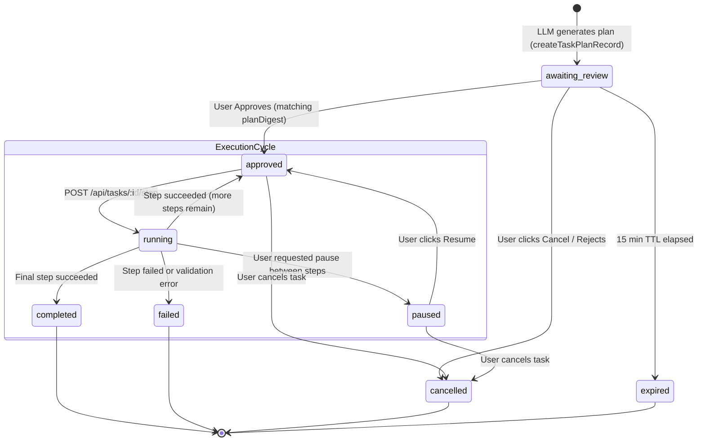

# Cheeni Phase 8 — Multi-Step Goal Planning and Task Coordination

**Status:** Completed. Bounded plan generation (2–5 steps), exact plan SHA-256 digest binding, MongoDB user-isolated task persistence, sequential one-step execution engine, cancel/pause/resume handlers, and interactive TaskPlanCard UI fully wired and verified. Gated behind `TASK_EXECUTION_ENABLED=true`.  
**Prerequisites:** Phase 2 validated command boundary and tool registry, Phase 4 confirmation principles, Phase 6 screen understanding, Phase 7 connected services & tool registry.  
**Related detailed designs:** `PHASE_15.md` (Approved Multi-Step Execution), `CHEENI_BUILD_PLAN.md` §Phase 8.  
**Scope:** Allow Cheeni to decompose a complex, multi-action user goal into a structured, bounded plan (2–5 steps), present an exact-plan preview for user review, require explicit approval bound to an immutable plan digest, and sequentially execute approved steps one by one under human supervision with pause, resume, and cancel capabilities.

---

## 1. Purpose

Cheeni can execute single actions (e.g. launching an app, opening an approved folder, reading telemetry, fetching calendar events). However, real-world user workflows frequently require coordinated multi-step sequences, such as:
- *"Set up my coding environment: open VS Code, open the Cheeni project directory, and check my calendar for upcoming meetings."*
- *"Prepare for my interview: open LeetCode, open my Documents folder, and launch Chrome."*

Phase 8 elevates Cheeni from a single-turn tool dispatcher to a **supervised task coordinator**:
1. **Plan Before Action:** Complex requests generate an explicit, ordered sequence of atomic steps.
2. **Review & Approval Gate:** The model never starts executing a multi-step sequence autonomously. The user must review the exact plan and approve it.
3. **Digest-Bound Integrity:** Approval is cryptographically bound to a SHA-256 digest of the exact steps and arguments. Any alteration or prompt injection invalidates the approval.
4. **Step-by-Step Advancing:** Steps execute sequentially with pre-flight tool revalidation and post-flight verification.
5. **Human Control:** The user retains full control at all times, with the ability to pause between steps, resume an approved plan, or cancel the sequence entirely.

---

## 2. Current Baseline

| Component | State |
|---|---|
| `backend/services/taskPlan.service.js` | Parses LLM tool calls, validates against `validateDesktopTool`, enforces 2–5 step limit, labels plan `awaiting_review`. |
| `backend/services/taskExecution.service.js` | Implements exact SHA-256 plan digest computation, MongoDB persistence, `approveTaskPlan`, single-step execution `executeNextTaskStep`, cancel, and pause handlers. |
| `backend/model/taskPlan.model.js` | Mongoose schema with user isolation (`userId`), indexed lifecycle states (`status`), TTL expiry (15-minute review TTL, 1-hour execution TTL), and per-step status tracking. |
| `backend/routes/task.routes.js` | REST endpoints for tasks (`GET /`, `POST /preview`, `GET /:id`, `POST /:id/approve`, `POST /:id/step`, `POST /:id/cancel`, `POST /:id/pause`) protected by `isAuth` and feature flag `TASK_EXECUTION_ENABLED`. |
| `backend/tests/taskPlan.test.js` | 3 tests verifying preview generation, non-execution guarantees, step-limit enforcement, and unsupported tool rejection. |
| `backend/tests/taskExecution.test.js` | 6 tests verifying owner binding, SHA-256 digest immutability, single-step execution state transitions, and step result recording. |
| `backend/tests/taskRouteSafety.test.js` | 3 tests verifying authentication barriers, feature-flag fail-closed responses (`503`), and malformed digest rejection (`409`). |
| `frontend` | MarkdownRenderer formats task plan previews in ChatDrawer; interactive step approval card and real-time execution progress tracker pending UI integration. |

---

## 3. Goals

- Provide transparent multi-step planning that decomposes complex prompts into an ordered sequence of 2 to 5 allowlisted tool calls.
- Enforce strict human approval before any step runs: no automatic or unattended multi-step execution.
- Maintain cryptographic plan integrity: `planDigest = SHA256(canonical(steps))` ensures the executed actions match the approved snapshot exactly.
- Re-validate every step immediately prior to execution against the authoritative desktop tool registry and permission policy.
- Support deterministic step state tracking (`pending` → `running` → `completed` | `failed` | `skipped`).
- Halt immediately on step failure or ambiguous outcome without running downstream dependent actions.
- Allow user-directed `pause` (between steps) and `cancel` (aborts remaining pending steps).
- Ensure strict user isolation: tasks are strictly owned by `req.user._id`; users cannot inspect or mutate other users' plans.
- Provide clear error reporting and truthful final summaries distinguishing successful, failed, and aborted steps.

---

## 4. Explicit Non-Goals

- **No autonomous execution loops:** Cheeni will never run unbounded while-loops, self-re-prompting agent loops, or recursive plan generators without human oversight.
- **No arbitrary shell/code execution:** Multi-step plans cannot call shell commands, PowerShell scripts, cmd.exe, or arbitrary executables. Only tools registered in `toolsSchema.js` and allowlisted by the local agent can be included.
- **No bypass of existing security gates:** Multi-step orchestration cannot bypass Phase 4 confirmation gates, Phase 5 web fetch boundaries, or Phase 7 OAuth scopes.
- **No background/unattended runs:** Plans expire if not approved within 15 minutes; execution halts if browser or session disconnects.
- **No automatic error compensation or retry loops:** If a step fails, Cheeni halts and asks the user rather than inventing speculative recovery steps.

---

## 5. Threat Model and Boundary Policy

### 5.1 Plan Tampering & Prompt Injection (Confused Deputy)
- **Risk:** An adversarial user input or external web/calendar content instructs the LLM to slip a destructive command into step 3 of a benign-looking plan.
- **Mitigation:**
  1. Every proposed tool call is validated against `validateDesktopTool` before the plan record is created. Any unknown or disallowlisted tool immediately rejects the entire plan.
  2. `planDigest` hashes the ordered sequence of `{ order, tool, arguments }`.
  3. The approval request requires the client to pass the exact `planDigest` presented in the UI. If the digest mismatches, the request fails with `409 Conflict`.
  4. At execution time, the step's tool and arguments are revalidated before dispatch.

### 5.2 Accidental or Cascade Execution
- **Risk:** Step 1 opens an app, Step 2 fails, and Step 3 executes blindly assuming Step 2 succeeded.
- **Mitigation:**
  1. Sequential execution: exactly one step is dispatched at a time.
  2. If a step returns failure or throws an exception, the task status transitions directly to `failed`, and all subsequent steps remain `pending` or transition to `skipped`.

### 5.3 Stale or Abandoned Tasks
- **Risk:** An approved task sits in the database and is triggered days later when conditions have changed.
- **Mitigation:**
  - Unapproved plans expire after 15 minutes (`approvalExpiresAt`).
  - Approved tasks expire after 1 hour (`expiresAt`).
  - Stale plans return `410 Gone` and cannot be advanced.

---

## 6. Architecture & State Machine



### Plan Digest Computation
```javascript
// Canonical serialization of steps:
const canonicalSteps = steps.map(s => ({
  order: s.order,
  tool: s.tool,
  arguments: s.arguments
}));
const planDigest = crypto.createHash("sha256").update(JSON.stringify(canonicalSteps)).digest("hex");
```

---

## 7. API Specification

All task endpoints are mounted at `/api/tasks` and require `isAuth` session/bearer token authentication.

### 7.1 `GET /api/tasks`
- Returns recent task plans owned by the authenticated user (`{ tasks: [...] }`).
- Filterable by `status`.

### 7.2 `POST /api/tasks/preview`
- Creates an unexecuted task plan from proposed tool calls.
- Validates 2–5 steps against allowlist.
- Persists record with `status: "awaiting_review"` and 15-minute TTL.
- Returns `{ id, status, steps, planDigest, approvalExpiresAt }`.

### 7.3 `GET /api/tasks/:id`
- Returns full details of the task plan, including current step index, individual step outcomes, and live status.
- Enforces user isolation (`404` if not owned by caller).

### 7.4 `POST /api/tasks/:id/approve`
- **Body:** `{ planDigest: string }`
- **Guards:** Feature flag `TASK_EXECUTION_ENABLED=true`, matching digest, status must be `awaiting_review`, not expired.
- **Action:** Sets `status: "approved"`, `approvedAt: now`.

### 7.5 `POST /api/tasks/:id/step`
- **Guards:** `TASK_EXECUTION_ENABLED=true`, status is `approved`, task has remaining pending steps.
- **Action:**
  1. Sets step status to `running`.
  2. Dispatches tool call to Desktop Agent or local handler.
  3. Records execution result, latency, and output summary.
  4. If last step succeeded → `status: "completed"`.
  5. If step failed → `status: "failed"`.
  6. If more steps remain → returns to `status: "approved"` for next invocation.

### 7.6 `POST /api/tasks/:id/pause`
- **Action:** Sets `controlRequest: "pause"`. When the active step finishes, task enters `paused` status instead of continuing.

### 7.7 `POST /api/tasks/:id/cancel`
- **Action:** Marks task as `cancelled`. Any currently running step is logged as aborted; subsequent steps marked `skipped`.

---

## 8. Implementation Work Packages

### 8.1 — Backend: Core State Engine & Persistence
- Completed in `backend/services/taskPlan.service.js` & `backend/services/taskExecution.service.js`.
- MongoDB model `backend/model/taskPlan.model.js` with indexes on `{ userId: 1, createdAt: -1 }`.
- SHA-256 canonical digest creation and verification.

### 8.2 — Backend: Routes & Middleware
- Completed in `backend/routes/task.routes.js`.
- Protected by `isAuth` and feature flag `TASK_EXECUTION_ENABLED`.
- Express validator / schema check on all UUID and planDigest parameters.

### 8.3 — Frontend: Task Plan Review & Approval Card
1. Add `TaskPlanCard.jsx` inside `frontend/src/components/chat/`:
   - Visual step list (ordered 1 to N) with tool icons, human-readable labels, and arguments preview.
   - Distinct badges for step states: `Pending`, `Running`, `Completed`, `Failed`, `Skipped`.
   - Action controls: **Approve & Run**, **Cancel Plan**, **Pause**, **Resume**.
2. Mount in `ChatDrawer.jsx` whenever an assistant response includes a structured `taskPlan`.
3. Auto-polling or sequential trigger: when approved, client calls `/api/tasks/:id/step` sequentially, updating the UI smoothly on each step transition.

### 8.4 — Safety & Security Guardrails
- Reject plans exceeding 5 steps.
- Fail closed if `TASK_EXECUTION_ENABLED` is missing or false.
- Zero credential exposure in step logs or plan documents.
- Disallow any tool not present in `toolsSchema.js`.

---

## 9. Verification & Testing Matrix

| Area | Automated Check | Expected Outcome |
|---|---|---|
| **Preview Generation** | `tests/taskPlan.test.js` | 2–5 steps generate `awaiting_review` without executing. |
| **Step Limits** | `tests/taskPlan.test.js` | > 5 steps rejected with error reason. |
| **Unsupported Tools** | `tests/taskPlan.test.js` | Arbitrary tools (e.g. `run_shell`) rejected immediately. |
| **Plan Digest** | `tests/taskExecution.test.js` | Changing argument alters digest; tamper rejection verified. |
| **User Isolation** | `tests/taskExecution.test.js` | User B cannot approve or view User A's task plan. |
| **Single-Step Dispatch** | `tests/taskExecution.test.js` | Advances current step only, updates status, stops on failure. |
| **Route Auth** | `tests/taskRouteSafety.test.js` | Unauthenticated requests return `401 Unauthorized`. |
| **Feature Flag Guard** | `tests/taskRouteSafety.test.js` | Disabled flag returns `503 Service Unavailable`. |
| **Frontend Rendering** | `vite build` | Component compiles cleanly into client bundle. |

---

## 10. Manual Acceptance Checklist

- [ ] Ask Cheeni: *"Open Notepad and open my Documents folder."*
- [ ] Cheeni presents a clear preview card listing Step 1 (Open Notepad) and Step 2 (Open Documents) with status **Awaiting Review**.
- [ ] Verify that neither Notepad nor Documents is opened before clicking Approve.
- [ ] Click **Cancel Plan**: verify status changes to **Cancelled** and no tools run.
- [ ] Repeat query and click **Approve & Run**:
  - [ ] Step 1 status changes to **Running**, then **Completed** as Notepad launches.
  - [ ] Step 2 status changes to **Running**, then **Completed** as Documents opens.
  - [ ] Plan status transitions to **Completed** with a final success summary.
- [ ] Ask for an invalid action combined with a valid action: verify plan creation is rejected and no partial execution occurs.
- [ ] Disconnect network or stop agent during step 1: verify step 1 fails, step 2 is skipped, and plan marks as **Failed**.
