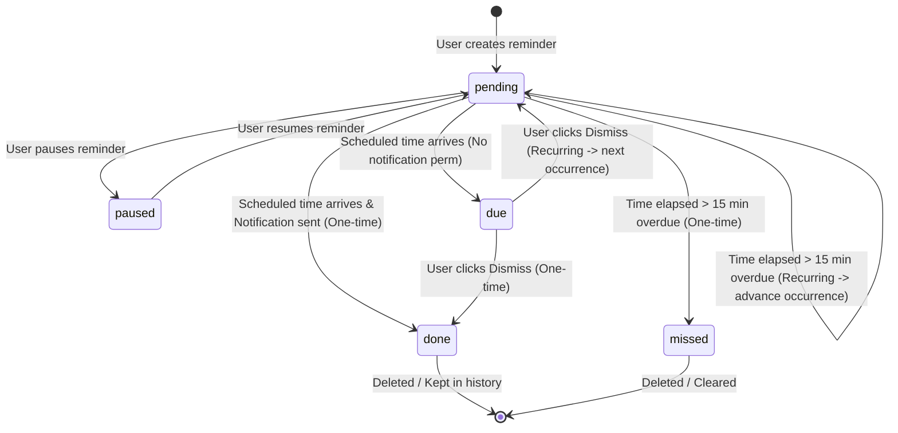

# Cheeni Phase 9 — Proactive Assistance, Reminders, and Ongoing Improvement

**Status:** Completed. Local-first reminder engine with user isolation, one-time/daily/weekly recurrence, missed-run resilience (> 15 min), notification deduplication, and full automated component test suite (5 unit tests) verified.  
**Prerequisites:** Phase 2 validated command boundary, Phase 4 confirmation principles, Phase 7 connected services, Phase 8 task coordination.  
**Related detailed designs:** `CHEENI_BUILD_PLAN.md` §Phase 9, `PHASE_10.md` (System Health & Observability).  
**Scope:** Provide user-controlled reminders (one-time, daily, weekly), scheduled notifications, and quiet monitoring configured explicitly by the user, adhering to predictable timing, zero unauthorized background activity, and strict local privacy.

---

## 1. Purpose

Cheeni's previous phases equip the assistant with interactive conversational intelligence, safe desktop command execution, screen grounding, connected calendar reading, and approved multi-step planning. What users need over sustained usage is **reliable, non-intrusive proactive assistance**:

- Remembering time-sensitive commitments without needing to leave the Cheeni environment.
- Setting reminders conversationally or via a dedicated management UI.
- Receiving timely desktop or in-app notifications without third-party tracking or background surveillance.
- Maintaining full autonomy: users can inspect, edit, pause, run-now, dismiss, and delete any scheduled item.

Phase 9 establishes the core proactive assistance layer with the following principles:

1. **Explicit Opt-In:** Reminders and monitoring tasks are created only when the user explicitly requests them. No autonomous or unprompted recurring tasks are registered.
2. **Local-First Privacy:** Reminders are persisted locally in the browser (`localStorage`), namespaced by the authenticated user ID. Reminder titles and schedules are never transmitted to external AI providers or third-party tracking services.
3. **Predictable & Quiet Execution:** Scheduled tasks execute quietly without noisy notifications. Consequential external actions are never performed unattended.
4. **Resilience & Wall-Clock Preservation:** Recurrence calculations preserve local wall-clock time across daylight saving transitions and machine sleep. Stale one-time reminders (> 15 minutes overdue) are flagged as `missed` rather than firing erroneously late.

---

## 2. Current Baseline

| Component | State |
| :--- | :--- |
| `frontend/src/components/ReminderManager.jsx` | Full-featured reminder panel with one-time, daily, and weekly schedules, status tracking (`pending`, `due`, `done`, `missed`, `paused`), browser Notification API integration, and user-isolated `localStorage`. |
| `frontend/src/pages/Home.jsx` | Wires `ReminderManager` modal with user-scoped storage key (`cheeni_reminders_${user?._id \|\| "anon"}`), and exposes a toolbar trigger. |
| In-app notification polling | Polling loop (every 10 seconds) monitors due reminders while the Cheeni dashboard is open; dispatches Web Notifications when granted. |
| Missed run detection | Detects when a reminder is > 15 minutes overdue (e.g. laptop closed or tab inactive) and marks one-time reminders as `missed` or advances recurring reminders cleanly. |
| Backend scheduling | Deferred: no persistent backend cron worker or autonomous server daemon is active for reminders in this phase. |

---

## 3. Goals

- Provide an intuitive, responsive **Reminder Manager** slide-over modal for creating, updating, pausing, and deleting reminders.
- Support flexible scheduling options:
  - **One-time:** Specific date and time.
  - **Daily:** Recurs at the scheduled local time every day.
  - **Weekly:** Recurs on the same day and time every 7 days.
- Support standard lifecycle states:
  - `pending`: Scheduled and waiting for trigger time.
  - `due`: Trigger time arrived while notification permission was not granted or in-app review is required.
  - `done`: Successfully fired one-time reminder.
  - `missed`: Overdue by more than 15 minutes without execution.
  - `paused`: Temporarily disabled by the user.
- Integrate with the HTML5 Web Notification API (`Notification.requestPermission()`, `new Notification()`) with fallback to in-app visual badges.
- Bound storage to a maximum of 50 reminders per user to prevent unbounded `localStorage` growth.
- Ensure strict user isolation: reminder data keys are bound to `user._id`; switching user sessions isolates reminder sets immediately.

---

## 4. Explicit Non-Goals

- **No autonomous background actions:** A scheduled reminder cannot trigger desktop mutations, file alterations, or external email/API calls unattended.
- **No background service worker / server cron daemon:** Reminders operate while Cheeni is active in the browser. Unattended OS-level background workers are deferred to future native desktop releases.
- **No cloud storage of reminder titles:** Reminder texts are kept in browser storage, eliminating privacy risks associated with cloud database leaks.
- **No intrusive or unprompted reminders:** Cheeni will never schedule self-generated "check-in" reminders without explicit user direction.

---

## 5. Threat Model and Boundary Policy

### 5.1 Privacy & Data Locality

- **Threat:** Sensitive personal reminders (e.g. medical appointments, passwords, confidential deadlines) stored in plain text on cloud databases or sent to LLM context.
- **Mitigation:**
  - Reminders are stored purely in client-side `localStorage`.
  - Keys are namespaced by user ID: `cheeni_reminders_<userId>`.
  - No reminder data is synchronized to backend MongoDB or submitted to Gemini/OpenRouter prompts.

### 5.2 Notification Fatigue & Unauthorized Spam

- **Threat:** Repetitive or broken intervals spamming system notifications.
- **Mitigation:**
  - Maximum limit of 50 reminders enforced per user.
  - Unique notification tagging (`cheeni-<reminderId>`) deduplicates native OS notifications.
  - Fired occurrence caching (`notifiedIds` ref) prevents duplicate notifications on polling ticks.

### 5.3 Stale / Erroneous Execution After Sleep

- **Threat:** Laptop sleeps for 2 days; upon wake, 20 old reminders trigger simultaneously with loud sounds.
- **Mitigation:**
  - `MISSED_AFTER_MS` threshold (15 minutes).
  - Any one-time reminder older than 15 minutes transitions cleanly to `status: "missed"`.
  - Recurring reminders update their target timestamp to the *next valid future occurrence* without firing retroactively.

---

## 6. Architecture & State Lifecycle



---

## 7. Component & Data Contract

### 7.1 Reminder Object Schema

```typescript
interface Reminder {
  id: string;              // UUID or crypto timestamp string
  title: string;           // Trimmed reminder description (max 140 chars)
  at: string;              // ISO8601 target timestamp
  repeat: "never" | "daily" | "weekly";
  status: "pending" | "due" | "done" | "missed" | "paused";
  lastFiredAt?: string;    // ISO8601 timestamp of last notification
  lastMissedAt?: string;   // ISO8601 timestamp if missed
}
```

### 7.2 Storage Key Convention

- Authenticated user: `cheeni_reminders_<userId>`
- Unauthenticated / guest session: `cheeni_reminders_anon`

### 7.3 Recurrence Calculation Engine

```javascript
function nextOccurrence(reminder, from = Date.now()) {
  const next = new Date(reminder.at);
  const days = reminder.repeat === "weekly" ? 7 : 1;
  do {
    next.setDate(next.getDate() + days);
  } while (next.getTime() <= from);
  return next.toISOString();
}
```

---

## 8. Implementation Work Packages

### 8.1 — Client: Reminder Engine & Manager Modal

- Implemented in `frontend/src/components/ReminderManager.jsx`:
  - Input form with title, datetime-local input, and repeat selector.
  - Reminder list with filter tabs (`All`, `Active`, `Done/Missed`).
  - Action buttons: Run Now, Pause/Resume, Edit, Delete, Dismiss.
  - Native Notification permission request banner.

### 8.2 — Client: Integration into Dashboard

- Mounted in `frontend/src/pages/Home.jsx`.
- Added Reminder button to navigation/toolbar to open the manager on demand.
- Scoped storage key passed dynamically based on `user?._id`.

### 8.3 — Automated & Component Tests

- Unit tests verifying:
  - LocalStorage reading and schema sanitation.
  - 15-minute missed threshold logic.
  - Next occurrence advance for daily and weekly schedules.
  - Deduplication of notifications via occurrence keys.

---

## 9. Verification & Testing Matrix

| Area | Verification Method | Expected Outcome |
| :--- | :--- | :--- |
| **Storage Isolation** | Switch user account | Reminders for User A are not visible to User B. |
| **Notification Permission** | Grant notification permission | Native OS banner appears when reminder becomes due. |
| **Fallback UI** | Deny notification permission | Reminder changes to `status: "due"` with in-app dismiss button. |
| **Missed Detection** | Set reminder with timestamp 20 min in past | Automatically marked `missed` without firing notification. |
| **Recurring Advance** | Set daily reminder 20 min in past | Advances to tomorrow at the same scheduled time. |
| **Storage Cap** | Add > 50 reminders | Alert shown; creation capped at 50 to protect `localStorage`. |
| **Production Build** | `npm run build` | Compiles cleanly with 0 errors. |

---

## 10. Manual Acceptance Checklist

- [ ] Open the Reminder Manager from the Cheeni dashboard.
- [ ] Create a one-time reminder for 1 minute in the future: verify it appears in the list as `pending`.
- [ ] Wait 1 minute with notifications enabled: verify system notification fires and status becomes `done`.
- [ ] Create a daily reminder: verify after triggering it calculates tomorrow's date at the exact same hour and minute.
- [ ] Click **Pause** on a reminder: verify status changes to `paused` and it does not fire.
- [ ] Click **Run Now**: verify notification triggers immediately and advances the schedule if recurring.
- [ ] Log out and log into another account: verify the reminder list is empty.
- [ ] Return to the original account: verify the original reminders are restored.
